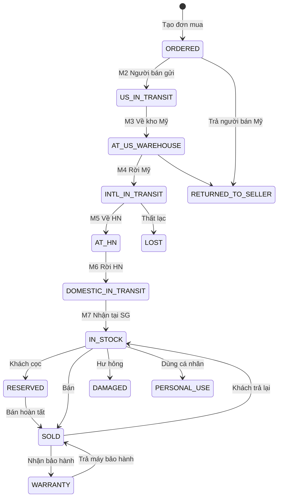
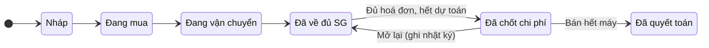

# 01 — Nghiệp vụ & Quy trình

> Tài liệu này là "hợp đồng nghiệp vụ" của hệ thống: mọi màn hình, API và bảng dữ liệu phía sau đều phải tuân theo đúng các định nghĩa và công thức ở đây. Phải chốt phần này trước khi viết code.

---

## 1. Hệ thống phải trả lời được những câu hỏi nào?

Một dashboard chỉ có giá trị khi trả lời ngay, chính xác, các câu hỏi mà chủ hàng tự hỏi mỗi ngày:

| # | Câu hỏi | Màn hình trả lời |
|---|---|---|
| Q1 | **Tôi đang có bao nhiêu tiền nằm trong hàng, và đang nằm ở đâu?** (Mỹ / đang bay / HN / SG) | Tổng quan → "Vốn theo chặng" |
| Q2 | Chuyến nào lãi, chuyến nào lỗ? Lãi bao nhiêu % trên vốn? | Chuyến hàng → Lãi lỗ |
| Q3 | Dòng máy nào (iPhone / iPad / Mac / AirPods…) cho lãi tốt nhất, quay vòng nhanh nhất? | Báo cáo → Theo dòng máy |
| Q4 | Máy nào tồn quá lâu cần xả giá? | Kho máy → Tuổi tồn |
| Q5 | Kiện nào đang trễ so với dự kiến? Đơn vị vận chuyển nào hay trễ? | Vận chuyển → Bảng tiến độ |
| Q6 | Tháng này thu bao nhiêu, chi bao nhiêu, lãi ròng bao nhiêu? | Thu chi + Báo cáo tháng |
| Q7 | Một máy cụ thể (tra theo IMEI/Serial): mua ở đâu, giá vốn bao nhiêu, đi qua các mốc nào, bán cho ai, còn bảo hành không? | Ô tìm kiếm toàn cục → Hồ sơ máy |
| Q8 | Doanh thu luỹ kế năm nay đã gần ngưỡng thuế chưa? | Tổng quan → Cảnh báo thuế |

---

## 2. Thuật ngữ thống nhất

| Thuật ngữ | Định nghĩa trong hệ thống |
|---|---|
| **Chuyến hàng (Lô)** | Một đợt nhập hàng, mã dạng `CH-2026-011`. Gồm 1..n đơn mua, 1..n kiện vận chuyển, và toàn bộ chi phí liên quan. Đây là đơn vị để tính lãi lỗ "theo chuyến". |
| **Đơn mua** | Một hoá đơn/đơn hàng tại Mỹ (Apple Store, Best Buy, Costco, Amazon, eBay, người bán cá nhân…). Một đơn có thể có nhiều máy. |
| **Máy** | Một đơn vị hàng hoá cụ thể, định danh bằng **Serial** và/hoặc **IMEI**. Mọi giá vốn và lãi lỗ cuối cùng đều quy về từng máy. |
| **Chặng (Leg)** | Một đoạn vận chuyển: ① Nội địa Mỹ, ② Mỹ → VN (về HN), ③ HN → SG. Mỗi chặng có thể có nhiều **kiện**; mỗi kiện có mã tracking, ngày gửi, ngày dự kiến, ngày nhận. |
| **Giá vốn về tay (Landed cost)** | Toàn bộ chi phí để một máy có mặt tại SG, sẵn sàng bán: giá mua + thuế mua + các loại cước + phụ phí, quy đổi VND. |
| **Phân bổ** | Chia một khoản chi phí chung (vd: cước cả kiện) cho từng máy theo quy tắc: số lượng / giá trị / cân nặng / thủ công. |
| **Lãi tạm tính** | Lãi của máy đã bán, nhưng chuyến chưa chốt đủ chi phí (còn chi phí dự toán hoặc chưa nhận hoá đơn cước). |
| **Lãi chốt** | Lãi của máy đã bán khi chuyến đã **chốt chi phí** — con số chính thức, bị khoá, mọi sửa đổi sau đó phải "mở lại chuyến" và được ghi nhật ký. |
| **Tuổi tồn** | Số ngày kể từ khi máy về tới SG đến hôm nay (nếu chưa bán) hoặc đến ngày bán. |
| **Chu kỳ vốn** | Số ngày từ lúc **trả tiền mua** đến lúc **thu đủ tiền bán** — thước đo tốc độ quay vòng vốn. |

---

## 3. Quy trình đầu-cuối

```mermaid
flowchart LR
    A[Đặt mua tại Mỹ<br/>+ thanh toán] --> B[Ship nội địa Mỹ<br/>người bán → kho forwarder]
    B --> C[Kho Mỹ<br/>chờ gom kiện]
    C --> D[Bay Mỹ → VN<br/>về Hà Nội]
    D --> E[Hà Nội<br/>nhận / thông quan]
    E --> F[Chuyển HN → SG]
    F --> G[Nhận máy tại SG<br/>kiểm máy, nhập kho]
    G --> H[Đăng bán]
    H --> I[Bán / Giao khách<br/>thu tiền]
    I --> J[Bảo hành / Đổi trả]

    style A fill:#e8f0fe,stroke:#4a6fa5
    style G fill:#e6f4ea,stroke:#3c8d5a
    style I fill:#fef7e0,stroke:#b8860b
```



**Khách đặt trước (pre-order):** khách có thể đặt cọc từ khi máy còn ở Mỹ. Hệ thống cho phép gắn đơn bán vào máy ở bất kỳ trạng thái nào trước khi bán — máy chuyển sang **"Khách đã cọc"** nhưng vẫn tiếp tục đi qua các chặng như bình thường.

---

## 4. Mốc thời gian — trọng tâm theo dõi

### 4.1. Mười mốc chuẩn của một máy

| Mã | Mốc | Ghi nhận khi nào | Nguồn dữ liệu |
|---|---|---|---|
| **M1** | Đặt hàng | Tạo đơn mua | `purchase_orders.ordered_at` |
| **M2** | Người bán gửi hàng | Kiện chặng ① "Gửi đi" | Kiện nội địa Mỹ `shipped_at` |
| **M3** | Về kho Mỹ | Kiện chặng ① "Đã nhận" | Kiện nội địa Mỹ `arrived_at` |
| **M4** | Rời Mỹ | Kiện chặng ② "Gửi đi" | Kiện Mỹ→VN `shipped_at` |
| **M5** | Về Hà Nội | Kiện chặng ② "Đã nhận" | Kiện Mỹ→VN `arrived_at` |
| **M6** | Rời Hà Nội | Kiện chặng ③ "Gửi đi" | Kiện HN→SG `shipped_at` |
| **M7** | **Nhận tại SG (nhập kho)** | Kiện chặng ③ "Đã nhận" | Kiện HN→SG `arrived_at` |
| **M8** | Bán | Tạo đơn bán hoàn tất | `sales.sold_at` |
| **M9** | Giao khách / thu đủ tiền | Xác nhận giao, thu đủ | `sales.delivered_at` |
| **M10** | Hết bảo hành shop | Tự tính khi bán | `sale_items.warranty_until` |

> **Nguyên tắc vàng:** người dùng **chỉ thao tác trên kiện** ("Gửi đi", "Đã nhận"), hệ thống tự sinh mốc cho **tất cả máy trong kiện**. Không bao giờ phải cập nhật từng máy một. Mỗi mốc lưu thành một sự kiện trong bảng `item_events` — vừa là dòng thời gian, vừa là căn cứ suy ra trạng thái.

### 4.2. Các khoảng thời gian được đo

```
M1 ──T1──► M2 ──T2──► M3 ──Chờ Mỹ──► M4 ──T3──► M5 ──Chờ HN──► M6 ──T4──► M7 ──Tồn kho──► M8 ──► M9
│ xử lý đơn │ nội địa Mỹ │ gom kiện   │ quốc tế   │ thông quan  │ HN→SG     │ tuổi tồn    │ bán│ giao
└──────────────────────────── Đặt → Về kho SG ──────────────────────────────┘
└──────────────────────────────────────── Chu kỳ vốn (trả tiền mua → thu tiền bán) ─────────────┘
```

| Chỉ số | Công thức | Dùng để |
|---|---|---|
| Thời gian nội địa Mỹ | M3 − M2 | So sánh người bán / hãng ship Mỹ |
| Thời gian chờ kho Mỹ | M4 − M3 | Phát hiện forwarder gom kiện chậm |
| Thời gian quốc tế | M5 − M4 | So sánh forwarder Mỹ → VN |
| Thời gian chờ tại HN | M6 − M5 | Phát hiện kẹt thông quan / chậm chuyển |
| Thời gian HN → SG | M7 − M6 | So sánh chành xe / đơn vị giao |
| Đặt → về kho | M7 − M1 | Tổng thời gian nhập hàng |
| Tuổi tồn | M8 (hoặc hôm nay) − M7 | Cảnh báo xả hàng |
| Chu kỳ vốn | Ngày thu đủ tiền − ngày trả tiền mua | Đo tốc độ quay vòng vốn |

### 4.3. Trạng thái máy (suy ra từ mốc)



*Máy có thể ở trạng thái "Khách đã cọc" từ bất kỳ bước nào trước khi về SG (đặt trước). Trạng thái "giữ hải quan" thể hiện ở cấp **kiện** (`HOLD`), không ở cấp máy.*

---

## 5. Cấu trúc chi phí

### 5.1. Các nhóm chi phí

| Nhóm | Ví dụ | Tiền tệ thường gặp | Gắn vào | Phân bổ mặc định | Vào giá vốn? |
|---|---|---|---|---|---|
| **A. Giá mua** | Đơn giá máy, sales tax, phí ship người bán thu, coupon/gift card (giảm trừ), phí chuyển đổi ngoại tệ của thẻ | USD | Đơn mua → máy | Đơn giá: trực tiếp · Thuế, phí, giảm giá: **theo giá trị** | ✅ |
| **B. Nội địa Mỹ** | Phí gửi từ người bán/nhà người mua hộ về kho forwarder | USD | Kiện chặng ① | **Theo số lượng** | ✅ |
| **C. Mỹ → VN** | Cước theo kg hoặc theo máy, phụ thu hàng điện tử/giá trị cao, bảo hiểm, thuế/phí thông quan nếu có | USD hoặc VND | Kiện chặng ② | Cước: **theo cân nặng** · Bảo hiểm, thuế: **theo giá trị** | ✅ |
| **D. HN → SG** | Cước chành xe / chuyển phát, bảo hiểm | VND | Kiện chặng ③ | **Theo số lượng** | ✅ |
| **E. Khác cấu thành giá vốn** | Phí kiểm máy, dán cường lực trước khi bán, lưu kho | VND | Chuyến hoặc máy | Theo số lượng / trực tiếp | ✅ |
| **F. Chi phí bán hàng** | Ship cho khách, phí COD, phí sàn, quà tặng kèm | VND | Đơn bán | Theo giá bán trong đơn | ❌ (trừ vào lãi máy) |
| **G. Chi phí vận hành chung** | Quảng cáo, điện thoại, phần mềm, mặt bằng | VND | Sổ thu chi | Không phân bổ | ❌ (trừ vào lãi ròng) |

> **Vì sao tách F và G khỏi giá vốn?** Giá vốn phải phản ánh đúng "một máy về tới tay tốn bao nhiêu" — con số dùng để định giá bán. Chi phí bán hàng phát sinh theo từng giao dịch; chi phí vận hành phát sinh bất kể bán hay không. Trộn chung sẽ làm sai lệch quyết định định giá.

### 5.2. Tỷ giá — điểm dễ sai nhất

- **Không dùng một tỷ giá chung cho mọi thứ.** Mỗi đơn mua lưu **tỷ giá thực tế đã trả** (đọc từ sao kê thẻ / số VND thực chi ÷ số USD), cộng **phí chuyển đổi ngoại tệ** của ngân hàng thành một dòng riêng.
- Chi phí trả bằng USD (vd: ship nội địa Mỹ) cũng lưu tỷ giá riêng của khoản đó.
- Bảng `exchange_rates` chỉ dùng để **gợi ý** tỷ giá khi nhập liệu và cho các khoản dự toán — không ghi đè tỷ giá thực tế.
- Khi chưa có sao kê: nhập tỷ giá dự kiến, đánh dấu "dự toán"; khi có sao kê thì sửa lại → hệ thống tự tính lại giá vốn.

### 5.3. Phương pháp phân bổ

| Phương pháp | Trọng số | Phù hợp với |
|---|---|---|
| Theo số lượng | 1 / máy | Cước nội địa, chi phí cố định theo kiện |
| Theo giá trị | Giá mua (VND) của máy | Sales tax, bảo hiểm, thuế, phí ngoại tệ, giảm giá |
| Theo cân nặng | Cân nặng máy (lấy mặc định theo mẫu, sửa được) | Cước quốc tế tính theo kg |
| Thủ công | Nhập số tiền từng máy | Forwarder báo giá riêng từng máy |

**Làm tròn:** dùng **phương pháp phần dư lớn nhất (largest remainder)** để tổng phân bổ **luôn khớp tuyệt đối** với tổng chi phí, không lệch dù 1 đồng. Ví dụ chia 100.000 đ cho 3 máy → 33.334 + 33.333 + 33.333.

---

## 6. Công thức tính

```
Giá mua quy đổi (máy)  = Đơn giá × tỷ giá
                         + phân bổ(sales tax + ship người bán − giảm giá) × tỷ giá
                         + phân bổ(phí chuyển đổi ngoại tệ)

Giá vốn về tay (máy)   = Giá mua quy đổi + phân bổ(B) + phân bổ(C) + phân bổ(D) + phân bổ(E)

Doanh thu thuần (máy)  = Giá bán − phân bổ giảm giá của đơn bán
Lãi gộp (máy)          = Doanh thu thuần − Giá vốn về tay
Lãi máy                = Lãi gộp − phân bổ chi phí bán hàng (F)
Biên lãi %             = Lãi máy ÷ Doanh thu thuần

Lãi chuyến (đã thực hiện) = Σ Lãi máy đã bán của chuyến
ROI chuyến (trên vốn đã bán) = Lãi chuyến ÷ Σ Giá vốn máy đã bán
Vốn còn đọng của chuyến    = Σ Giá vốn máy chưa bán

Lãi ròng tháng         = Σ Lãi máy bán trong tháng − Chi phí vận hành (G) trong tháng − Thuế
```

### 6.1. Ví dụ tính toán (số liệu minh hoạ)

Chuyến **CH-2026-011**, một đơn mua tại bang không có sales tax, tỷ giá thực tế **26.400 đ/USD** (minh hoạ):

| Máy | Đơn giá | Cân nặng | Giá mua VND | Nội địa Mỹ ($20, theo SL) | Cước Mỹ→VN (684.000 đ, theo kg) | Phụ thu 1% (540.408 đ, theo giá trị) | HN→SG (150.000 đ, theo SL) | **Giá vốn về tay** |
|---|---:|---:|---:|---:|---:|---:|---:|---:|
| iPhone Pro Max 256GB | $1.199 | 0,6 kg | 31.653.600 | 176.000 | 228.000 | 316.536 | 50.000 | **32.424.136** |
| iPad Air 11 | $599 | 0,9 kg | 15.813.600 | 176.000 | 342.000 | 158.136 | 50.000 | **16.539.736** |
| AirPods Pro | $249 | 0,3 kg | 6.573.600 | 176.000 | 114.000 | 65.736 | 50.000 | **6.979.336** |
| **Tổng** | **$2.047** | **1,8 kg** | **54.040.800** | **528.000** | **684.000** | **540.408** | **150.000** | **55.943.208** |

Bán ra:

| Máy | Giá bán | Chi phí bán | Giá vốn | **Lãi máy** | Biên lãi |
|---|---:|---:|---:|---:|---:|
| iPhone Pro Max | 34.500.000 | 30.000 (ship) | 32.424.136 | **2.045.864** | 5,93% |
| iPad Air | 17.200.000 | 0 | 16.539.736 | **660.264** | 3,84% |
| AirPods Pro | *chưa bán* | — | 6.979.336 | — | — |

→ Lãi chuyến đã thực hiện **2.706.128 đ**, ROI trên vốn đã bán **5,53%**, vốn còn đọng **6.979.336 đ** (AirPods).

> Toàn bộ ví dụ này đã được nạp vào cơ sở dữ liệu thử (`db/seed-vi-du.sql`) và các view báo cáo trả về **đúng từng đồng** như bảng trên.

---

## 7. Ghi nhận lãi lỗ: Tạm tính → Chốt



Quy tắc:

1. **Lãi được ghi nhận tại thời điểm bán** (đúng yêu cầu: "lãi lỗ được xác nhận khi máy được bán"). Máy chưa bán **không có lãi** — chỉ có *lãi ước tính* nếu người dùng nhập giá thị trường tham khảo, hiển thị tách riêng.
2. Khi bán, hệ thống chụp lại **giá vốn tại thời điểm bán** (`cost_snapshot_vnd`). Nếu sau đó có chi phí phát sinh thêm (vd: hoá đơn cước HN→SG đến muộn), giá vốn được tính lại và báo cáo hiển thị chênh lệch so với lúc bán.
3. Lãi hiển thị nhãn **"Tạm tính"** cho đến khi chuyến được **chốt chi phí**. Điều kiện chốt: mọi máy đã về SG (hoặc đã xử lý mất/trả), không còn khoản chi phí nào đánh dấu dự toán.
4. Sau khi chốt, mọi sửa đổi ảnh hưởng giá vốn bị chặn; muốn sửa phải **"Mở lại chuyến"**, có lý do, ghi vào nhật ký kiểm toán.

---

## 8. Tình huống đặc biệt (phải xử lý ngay từ thiết kế)

| # | Tình huống | Cách hệ thống xử lý |
|---|---|---|
| 1 | Một đơn mua có máy về hai kiện khác nhau | Máy gắn vào kiện độc lập với đơn mua (quan hệ nhiều–nhiều qua `shipment_items`). |
| 2 | Một kiện gom máy của nhiều chuyến | Kiện không bắt buộc thuộc một chuyến; chi phí kiện phân bổ cho máy, máy thuộc chuyến nào thì lãi tính về chuyến đó. |
| 3 | Hoá đơn cước đến sau khi máy đã bán | Lãi "tạm tính" tự cập nhật; báo cáo hiện chênh lệch so với giá vốn lúc bán. |
| 4 | Người bán Mỹ hoàn tiền một phần (price adjustment, cashback) | Ghi khoản giảm trừ trên đơn mua → tự phân bổ lại theo giá trị. |
| 5 | Trả máy lại cho người bán Mỹ | Máy chuyển "Đã trả người bán", ghi khoản hoàn tiền; các chi phí đã phân bổ cho máy đó được chọn: phân bổ lại cho máy còn lại hoặc ghi lỗ. |
| 6 | Máy thất lạc / hư hỏng | Trạng thái "Thất lạc"/"Hư hỏng", giá vốn ghi nhận **lỗ**; nếu có bồi thường bảo hiểm ghi khoản thu. |
| 7 | Kiện bị giữ tại hải quan | Kiện trạng thái `HOLD`, cảnh báo đỏ, đếm số ngày bị giữ. |
| 8 | Khách đặt cọc trước khi máy về | Đơn bán trạng thái "Đã cọc", khoản cọc vào sổ thu; máy "Khách đã cọc" nhưng vẫn đi tiếp các chặng. |
| 9 | Khách trả lại / đổi máy | Huỷ dòng bán (`voided_at`), máy quay về tồn kho, ghi khoản hoàn tiền; lịch sử giữ nguyên. |
| 10 | Bán combo (iPhone + ốp, sạc) | Một đơn bán nhiều dòng; giảm giá cả đơn phân bổ theo giá bán từng dòng. |
| 11 | Khách trả góp / nợ | Đơn bán có nhiều lần thu tiền; "Còn phải thu" = tổng tiền − đã thu; danh sách công nợ khách. |
| 12 | Chưa trả tiền cước cho forwarder | Chi phí có `paid_at` rỗng → công nợ phải trả; vẫn tính vào giá vốn. |
| 13 | Rút một máy ra dùng cá nhân / tặng | Trạng thái "Dùng cá nhân", loại khỏi tồn kho kinh doanh, không ghi doanh thu. |
| 14 | Nhập trùng IMEI/Serial | Bị chặn ở cơ sở dữ liệu (khoá duy nhất) và cảnh báo ngay khi quét mã. |
| 15 | Thanh toán đơn Mỹ bằng nhiều nguồn (thẻ + gift card) | Gift card ghi là giảm trừ hoặc tài khoản riêng; phần thẻ ghi tỷ giá thực tế. |

---

## 9. Thu chi (sổ quỹ)

- **Nhiều tài khoản:** tiền mặt, từng tài khoản ngân hàng, thẻ tín dụng, ví điện tử, tài khoản USD (nếu có). Số dư mỗi tài khoản = số dư đầu kỳ + Σ thu − Σ chi.
- **Tự động sinh bút toán:** thanh toán đơn mua, trả cước, khách cọc, khách thanh toán, chi phí bán hàng → hệ thống tự ghi vào sổ, liên kết ngược về chứng từ gốc. Người dùng chỉ nhập tay các khoản **vận hành chung** (quảng cáo, điện thoại…) và **góp/rút vốn**.
- **Chuyển tiền nội bộ / đổi ngoại tệ:** hai bút toán (ra – vào) cùng một nhóm, không ảnh hưởng lãi lỗ.
- **Phân biệt rõ dòng tiền và lãi lỗ:** trả tiền mua hàng là *dòng tiền ra* nhưng **chưa phải chi phí** — nó chỉ thành giá vốn khi máy được bán. Đây là lỗi phổ biến nhất khi quản lý bằng Excel: lấy "tổng thu − tổng chi" làm lãi, trong khi phần chênh lệch thực chất đang nằm trong hàng tồn.
- **Đối soát:** cuối tháng so số dư hệ thống với số dư ngân hàng thực tế; chênh lệch hiển thị để kiểm tra.
