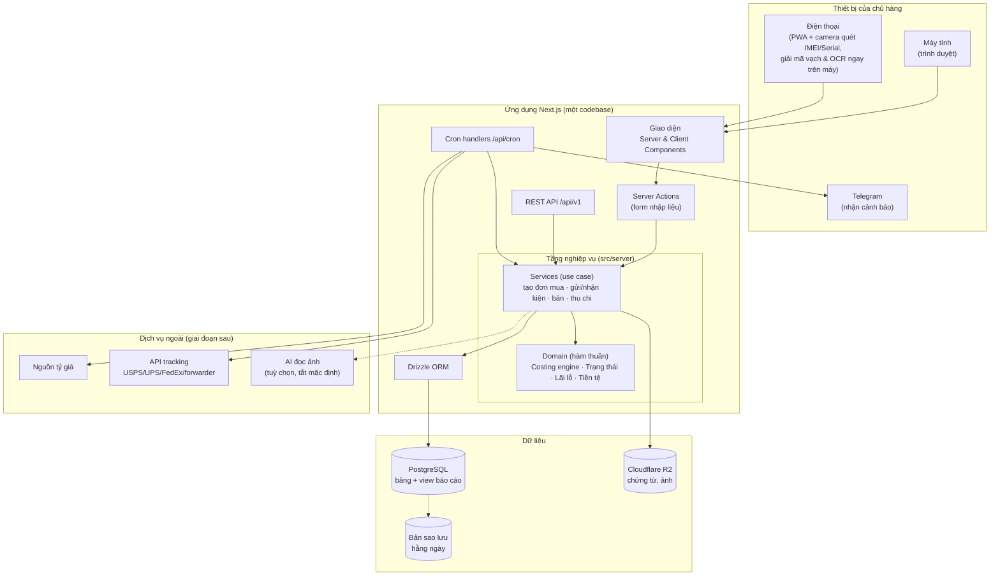
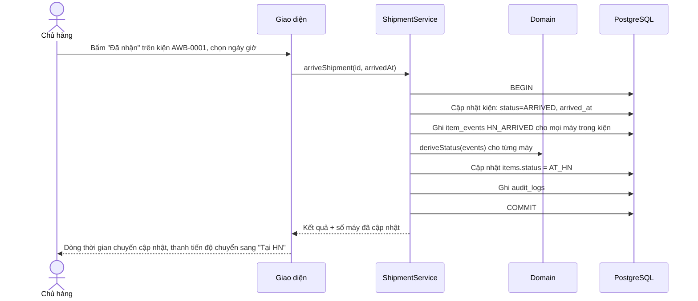

# 02 — Kiến trúc & Công nghệ

## 1. Nguyên tắc thiết kế

| Nguyên tắc | Hệ quả kỹ thuật |
|---|---|
| **Một người dùng** → tối giản vận hành, không cần phân quyền phức tạp | Một ứng dụng duy nhất (modular monolith), một cơ sở dữ liệu, không microservice. |
| **Dữ liệu tài chính** → chính xác tuyệt đối | Tiền VND là số nguyên; nhân tỷ giá bằng thư viện số thập phân; mọi thao tác ghi nằm trong transaction; ràng buộc toàn vẹn đặt ngay trong CSDL (không chỉ ở giao diện). |
| **Không mất dữ liệu, truy vết được mọi thay đổi** | Xoá mềm, nhật ký kiểm toán (audit log), sao lưu tự động hằng ngày + xuất dữ liệu bất kỳ lúc nào. |
| **Nhập liệu nhanh, cả trên điện thoại** | Giao diện responsive + PWA, quét mã vạch IMEI/Serial bằng camera, thao tác theo kiện thay vì từng máy. |
| **Dữ liệu thuộc về chủ hàng** | Dùng PostgreSQL chuẩn, xuất Excel/CSV/SQL dump được; không khoá vào nền tảng độc quyền. |
| **Có thể mở rộng sau này** | Tầng nghiệp vụ tách khỏi giao diện; API REST rõ ràng để sau gắn bot Telegram, ứng dụng di động, hoặc thêm nhân viên. |

---

## 2. So sánh phương án

| Tiêu chí | **A. Next.js full-stack + PostgreSQL** *(đề xuất)* | B. React SPA + API riêng (NestJS/FastAPI) | C. Low-code (Google Sheets/AppSheet/Airtable) |
|---|---|---|---|
| Thời gian ra bản dùng được | Nhanh | Chậm hơn ~30–40% (2 codebase) | Rất nhanh |
| Độ chính xác giá vốn / phân bổ | ✅ Toàn quyền kiểm soát | ✅ | ⚠️ Công thức phân bổ nhiều tầng rất dễ vỡ |
| Ràng buộc chống sai dữ liệu (trùng IMEI, bán 2 lần…) | ✅ Ở cấp CSDL | ✅ | ❌ Yếu |
| Dòng thời gian, cảnh báo, quét mã vạch | ✅ | ✅ | ⚠️ Hạn chế |
| Chi phí vận hành | Thấp | Trung bình | Thấp nhưng tăng theo số bản ghi/người dùng |
| Bảo trì cho 1 người | ✅ Một codebase, một ngôn ngữ | ❌ Hai hệ thống phải đồng bộ | ✅ |
| Khả năng mở rộng | ✅ | ✅ | ❌ |

**Kết luận:** Chọn **phương án A**. Phương án B chỉ đáng khi có nhiều client độc lập hoặc nhóm phát triển riêng frontend/backend — không phải trường hợp này. Phương án C phù hợp để *thử ý tưởng* vài tuần, nhưng sẽ gãy khi số chuyến và các tình huống đặc biệt (mục 8, tài liệu 01) tăng lên.

---

## 3. Công nghệ cụ thể

| Tầng | Công nghệ | Lý do chọn |
|---|---|---|
| Ngôn ngữ | **TypeScript** (toàn bộ) | Một ngôn ngữ cho cả frontend và backend; kiểu dữ liệu chặt giúp tránh lỗi tiền tệ. |
| Framework | **Next.js** (App Router, bản ổn định mới nhất lúc khởi tạo) | UI + API trong một dự án; Server Components cho trang báo cáo nhanh; Server Actions cho form. |
| Giao diện | **Tailwind CSS + shadcn/ui** (Radix UI), icon **lucide** | Bộ component chuyên nghiệp, truy cập tốt (a11y), tuỳ biến hoàn toàn, có sẵn chế độ tối. |
| Bảng dữ liệu | **TanStack Table** | Lọc, sắp xếp, nhóm, chọn nhiều dòng, ẩn/hiện cột — cần cho màn Kho máy. |
| Biểu đồ | **Recharts** (qua shadcn/ui Charts) | Đủ cho cột, đường, tròn, thác nước; đồng bộ giao diện. |
| Form & kiểm tra | **React Hook Form + Zod** | Lược đồ Zod dùng chung cho frontend và backend — một nguồn sự thật cho validation. |
| Trạng thái trên URL | **nuqs** | Bộ lọc, kỳ báo cáo lưu trên URL → đánh dấu trang, quay lại đúng chỗ. |
| ORM & migration | **Drizzle ORM + drizzle-kit** | Gần SQL, mạnh cho truy vấn báo cáo; migration có kiểm soát phiên bản. |
| Cơ sở dữ liệu | **PostgreSQL 16+** (dịch vụ quản lý: Neon hoặc Supabase, vùng Singapore) | ACID, `numeric` chính xác, view, ràng buộc mạnh; sao lưu/khôi phục theo thời điểm (PITR). |
| Số thập phân | **decimal.js** | Nhân USD × tỷ giá không sai số dấu phẩy động. |
| Xác thực | **Better Auth**: email + mật khẩu + **TOTP 2FA** (tuỳ chọn passkey) | Một tài khoản duy nhất; tắt đăng ký sau khi tạo tài khoản chủ. |
| Lưu chứng từ | **Cloudflare R2** (tương thích S3), upload bằng presigned URL | Rẻ, không phí băng thông tải xuống; ảnh hoá đơn, AWB, tờ khai. |
| Tác vụ định kỳ | **Cron** của nền tảng → gọi route `/api/cron/*` có khoá bí mật | Tỷ giá, cảnh báo trễ, tồn lâu, hạn đổi trả, sao lưu. |
| Thông báo | **Telegram Bot API** | Miễn phí, tức thì, xem trên điện thoại. |
| Xuất file | **ExcelJS** (xlsx); PDF ở giai đoạn sau | Báo cáo gửi kế toán, lưu trữ. |
| Quét mã vạch từ camera & ảnh | **zxing-wasm** (WebAssembly, chạy trong Web Worker) + **BarcodeDetector API** khi trình duyệt có | Đọc nhiều mã trên một ảnh; chạy được trên Safari iPhone (vốn chưa có BarcodeDetector). Chi tiết: [tài liệu 07](07-quet-ma-va-nhap-lieu.md). |
| Nhận dạng chữ (OCR) | **Tesseract.js** | Đọc IMEI/Serial từ ảnh chụp màn hình *Cài đặt › Giới thiệu*; chạy trên thiết bị, miễn phí. |
| AI đọc ảnh *(tuỳ chọn, tắt mặc định)* | **Claude API** qua SDK `@anthropic-ai/sdk`, gọi từ máy chủ | Chỉ cho ảnh khó và hoá đơn → đơn mua; kết quả vẫn qua kiểm tra và bước duyệt. |
| Kiểm thử | **Vitest** + **fast-check** (kiểm thử thuộc tính cho phân bổ) + **Playwright** (E2E) | Bộ máy tính giá vốn phải được kiểm thử kỹ nhất. |
| Chất lượng mã | ESLint + Prettier + TypeScript strict | |
| CI/CD | **GitHub Actions** → triển khai tự động khi merge `main` | |
| Giám sát lỗi | Sentry (gói miễn phí) — tuỳ chọn | |

---

## 4. Sơ đồ kiến trúc tổng thể



**Luồng dữ liệu điển hình — "Đánh dấu kiện Mỹ→VN đã về Hà Nội":**



---

## 5. Cấu trúc thư mục dự kiến

```
iPre-He-Thong-Quan-Tri/
├── src/
│   ├── app/                          # Next.js App Router
│   │   ├── (auth)/dang-nhap/         # Đăng nhập + 2FA
│   │   ├── (app)/                    # Khu vực đã đăng nhập (layout có sidebar)
│   │   │   ├── page.tsx              # Tổng quan
│   │   │   ├── chuyen-hang/          # Danh sách + [id] chi tiết chuyến
│   │   │   ├── don-mua/
│   │   │   ├── van-chuyen/           # Bảng tiến độ kiện
│   │   │   ├── kho/                  # Kho máy + [id] hồ sơ máy
│   │   │   ├── ban-hang/             # Bán nhanh + danh sách đơn bán
│   │   │   ├── thu-chi/
│   │   │   ├── bao-cao/
│   │   │   ├── danh-muc/             # Mẫu máy, nơi mua, đơn vị vận chuyển, tài khoản, khách
│   │   │   └── cai-dat/
│   │   └── api/
│   │       ├── v1/…                  # REST API
│   │       └── cron/…                # Tác vụ định kỳ
│   ├── server/
│   │   ├── domain/                   # HÀM THUẦN — không truy cập DB, kiểm thử 100%
│   │   │   ├── money.ts              # VND, USD, quy đổi, làm tròn
│   │   │   ├── allocation.ts         # Phân bổ phần dư lớn nhất
│   │   │   ├── costing.ts            # Tính giá vốn từng máy
│   │   │   ├── item-status.ts        # Máy trạng thái: sự kiện → trạng thái
│   │   │   ├── identifiers.ts        # Phân loại & kiểm tra IMEI/Serial/Part No. (dùng chung với trình duyệt)
│   │   │   └── profit.ts             # Lãi máy, lãi chuyến, ROI
│   │   ├── services/                 # Use case, transaction, audit
│   │   ├── db/
│   │   │   ├── schema/               # Drizzle schema (từ db/schema-draft.sql)
│   │   │   ├── views.sql
│   │   │   └── migrations/
│   │   ├── integrations/             # fx, tracking, telegram, storage, ai-label-reader (tuỳ chọn)
│   │   └── auth/
│   ├── components/
│   │   ├── ui/                       # shadcn/ui
│   │   ├── data-table/
│   │   ├── charts/
│   │   ├── timeline/                 # Dòng thời gian máy/chuyến, Gantt chặng
│   │   ├── money-input/              # Nhập "34,5tr" → 34.500.000
│   │   ├── entry-grid/               # Lưới nhập liệu kiểu bảng tính (dán từ Excel)
│   │   └── scanner/                  # Camera, ảnh, máy quét USB · zxing-wasm · Tesseract.js (Web Worker)
│   └── lib/
│       ├── format.ts                 # Định dạng VND/USD/ngày giờ vi-VN
│       └── validators/               # Lược đồ Zod dùng chung
├── tests/
│   ├── unit/                         # domain/*
│   ├── integration/                  # services + PostgreSQL thật
│   └── e2e/                          # Playwright: luồng nhập chuyến → bán
├── db/
│   ├── schema-draft.sql              # Lược đồ thiết kế (đã chạy thử trên PostgreSQL 16)
│   └── seed-vi-du.sql                # Dữ liệu ví dụ khớp tài liệu 01
├── docs/                             # Bộ tài liệu kế hoạch này
└── .github/workflows/ci.yml
```

---

## 6. Triển khai & chi phí

| | **Phương án triển khai 1 — Dịch vụ quản lý** *(đề xuất)* | Phương án triển khai 2 — VPS tự quản |
|---|---|---|
| Thành phần | Vercel (ứng dụng) + Neon/Supabase (PostgreSQL) + Cloudflare R2 | 1 VPS Singapore (2 vCPU/2–4 GB) chạy Docker Compose: Next.js + PostgreSQL + Caddy (HTTPS) |
| Vận hành | Gần như bằng 0: tự cập nhật, tự sao lưu, có PITR | Tự lo cập nhật bảo mật hệ điều hành, sao lưu, giám sát |
| Chi phí tham khảo* | ~20–45 USD/tháng | ~6–15 USD/tháng |
| Phù hợp khi | Muốn "dùng, không phải trông" | Muốn tiết kiệm tối đa và có người kỹ thuật hỗ trợ |

\* *Giá tham khảo, phải kiểm tra bảng giá tại thời điểm đăng ký. **Lưu ý điều khoản:** gói miễn phí (Hobby) của Vercel chỉ dành cho mục đích cá nhân phi thương mại — hệ thống phục vụ kinh doanh nên dùng gói trả phí, hoặc chọn nền tảng có gói miễn phí cho phép dùng thương mại.*

**Môi trường:**
- `local`: PostgreSQL chạy bằng Docker, dữ liệu mẫu từ `db/seed-vi-du.sql`.
- `preview`: tự tạo cho mỗi Pull Request, dùng nhánh CSDL riêng (Neon branching) — kiểm tra trước khi đưa lên thật.
- `production`: dữ liệu thật.

**CI (GitHub Actions) chạy ở mỗi Pull Request:** kiểm tra kiểu (tsc) → lint → unit test → integration test với PostgreSQL dịch vụ → kiểm tra migration → build.

---

## 7. Bảo mật

Dù chỉ một người dùng, dữ liệu tài chính và thông tin khách hàng phải được bảo vệ như hệ thống doanh nghiệp:

1. **Đăng nhập:** mật khẩu mạnh + **xác thực 2 lớp TOTP** (Google Authenticator/1Password); tuỳ chọn passkey (Face ID). Khoá đăng ký sau khi tạo tài khoản chủ.
2. **Phiên:** cookie `HttpOnly`, `Secure`, `SameSite=Lax`; tự hết hạn khi không hoạt động; trang "Phiên đăng nhập" để đăng xuất thiết bị lạ.
3. **Chống dò mật khẩu:** giới hạn số lần thử, trễ tăng dần; cảnh báo Telegram khi đăng nhập từ thiết bị mới.
4. **Bí mật:** khoá API, chuỗi kết nối CSDL chỉ nằm trong biến môi trường của nền tảng, **không bao giờ** commit vào repo.
5. **Chứng từ:** bucket R2 ở chế độ riêng tư; chỉ truy cập qua URL ký có thời hạn ngắn.
6. **Sao lưu:** PITR của dịch vụ CSDL + bản `pg_dump` hằng ngày mã hoá lưu sang nơi khác (R2) + nút "Xuất toàn bộ dữ liệu" (ZIP gồm CSV/XLSX). Diễn tập khôi phục mỗi quý.
7. **Toàn vẹn:** không xoá cứng dữ liệu tài chính; mọi sửa đổi ghi `audit_logs` (trước/sau).
8. **Dữ liệu cá nhân khách hàng:** chỉ thu thập thông tin cần thiết (tên, số điện thoại, địa chỉ giao), không chia sẻ ra ngoài — xem phần pháp lý ở tài liệu 06.

---

## 8. Yêu cầu phi chức năng

| Hạng mục | Mục tiêu |
|---|---|
| Quy mô dữ liệu | Thiết kế thoải mái cho > 10.000 máy/năm (thực tế dự kiến vài trăm đến vài nghìn) |
| Tốc độ | Trang Tổng quan < 1 giây; tìm IMEI < 300 ms |
| Múi giờ | Lưu UTC; hiển thị **Asia/Ho_Chi_Minh**; ngày đặt hàng tại Mỹ hiển thị kèm giờ địa phương khi cần |
| Định dạng | VND `34.500.000 ₫`, USD `$1,199.00`, ngày `03/11/2026` |
| Ngôn ngữ | Tiếng Việt (giao diện), mã nguồn và tên bảng tiếng Anh |
| Thiết bị | Máy tính ≥ 1280px (đầy đủ), điện thoại ≥ 375px (nhập nhanh, quét mã, bán hàng) |
| Khả dụng | 99,5% (phụ thuộc nền tảng); dữ liệu không mất quá 24 giờ trong trường hợp xấu nhất (thực tế ~0 với PITR) |
