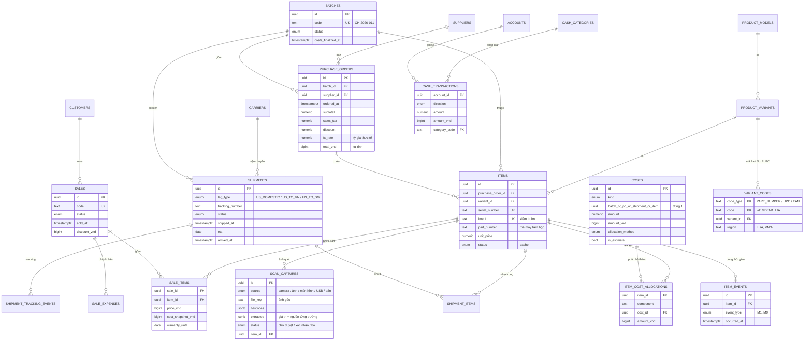

# 03 — Thiết kế Cơ sở dữ liệu

> Lược đồ đầy đủ: [`db/migrations/0001_khoi_tao.sql`](../db/migrations/0001_khoi_tao.sql) — **đã chạy thử trên PostgreSQL 16**, kèm dữ liệu ví dụ [`db/seed-vi-du.sql`](../db/seed-vi-du.sql). Các view báo cáo trả về đúng từng đồng như ví dụ ở tài liệu 01.

## 1. Sơ đồ quan hệ (ERD)



---

## 2. Danh mục bảng

### Nhóm danh mục

| Bảng | Mục đích | Ghi chú |
|---|---|---|
| `product_models` | Dòng máy: iPhone 17 Pro Max, MacBook Air 13 M4… | Phân loại `category` để báo cáo theo dòng |
| `product_variants` | Cấu hình cụ thể: dung lượng, màu, chip, RAM | `default_weight_kg` dùng phân bổ cước |
| `variant_codes` | **Mã máy → cấu hình**: Part No. (mỗi thị trường một mã), UPC/EAN | Quét hộp là tự điền dòng máy, dung lượng, màu; mã mới được "học" sau lần gán đầu tiên |
| `suppliers` | Nơi mua tại Mỹ | Bang (`us_state`) và số ngày đổi trả mặc định |
| `carriers` | Đơn vị vận chuyển / forwarder | Mẫu URL tracking, thời gian giao mặc định để tự gợi ý ETA |
| `accounts` | Tài khoản tiền | Mỗi tài khoản một tiền tệ |
| `cash_categories` | Danh mục thu chi | `is_operating` = chi phí vận hành chung |
| `customers` | Khách hàng | Dữ liệu cá nhân — thu tối thiểu |
| `exchange_rates` | Lịch sử tỷ giá tham khảo | Chỉ để gợi ý, không thay tỷ giá thực tế |

### Nhóm nghiệp vụ chính

| Bảng | Mục đích | Ràng buộc quan trọng |
|---|---|---|
| `batches` | Chuyến hàng | Mã chuyến duy nhất; trạng thái vòng đời; mốc chốt chi phí |
| `purchase_orders` | Đơn mua tại Mỹ | `total_vnd` là **cột tự tính** từ subtotal + thuế + ship − giảm giá, × tỷ giá, + phí ngoại tệ |
| `items` | Từng máy | **Serial, IMEI1, IMEI2 duy nhất** (khi khác rỗng, chưa xoá); **IMEI phải đúng số kiểm tra Luhn**; serial in hoa; lưu Part No. thực tế của hộp |
| `shipments` | Kiện / chặng | `arrived_at ≥ shipped_at` |
| `shipment_items` | Máy trong kiện | **Mỗi máy chỉ thuộc 1 kiện trên mỗi chặng** (khoá ngoại tổ hợp `(shipment_id, leg_type)`) |
| `shipment_tracking_events` | Nhật ký tracking | Nhập tay hoặc đồng bộ API |
| `item_events` | **Dòng thời gian của máy** — nguồn sự thật cho các mốc M1–M9 | Chỉ thêm, không sửa (append-only) |
| `costs` | Mọi chi phí cấu thành giá vốn | Gắn **đúng một** đối tượng (chuyến / đơn mua / kiện / máy); chi phí VND phải có tỷ giá = 1 |
| `cost_manual_shares` | Số tiền từng máy khi phân bổ thủ công | |
| `item_cost_allocations` | **Kết quả của costing engine** — mỗi dòng là một thành phần giá vốn của một máy | Duy nhất theo (máy, thành phần, chi phí) |
| `sales` | Đơn bán | Trạng thái: Đã cọc / Hoàn tất / Huỷ; số hoá đơn điện tử (nếu có) |
| `sale_items` | Dòng bán | **Một máy chỉ có một dòng bán đang hiệu lực**; giá vốn chụp lại lúc bán |
| `sale_expenses` | Chi phí bán hàng | Không vào giá vốn |
| `cash_transactions` | Sổ thu chi | Liên kết tối đa một chứng từ nguồn; chuyển tiền nội bộ dùng `transfer_group_id` |

### Nhóm hệ thống

| Bảng | Mục đích |
|---|---|
| `attachments` | Chứng từ, ảnh gắn với bất kỳ đối tượng nào (hoá đơn, AWB, tờ khai, ảnh máy) |
| `scan_captures` | Mỗi lần quét / mỗi ảnh tải lên: ảnh gốc, mã vạch đọc được, chữ OCR, kết quả AI (nếu bật), giá trị trích xuất kèm **nguồn của từng trường**; là "Hộp chờ duyệt" — xem [tài liệu 07](07-quet-ma-va-nhap-lieu.md) |
| `audit_logs` | Nhật ký thay đổi (trước/sau) |
| `app_settings` | Cấu hình: ngưỡng cảnh báo, phương pháp phân bổ mặc định, ngưỡng doanh thu thuế |
| *(bảng của Better Auth)* | `user`, `session`, `account`, `verification`, `two_factor` — do thư viện tạo |

---

## 3. Các quyết định thiết kế then chốt

### 3.1. Kiểu dữ liệu tiền tệ
- **VND → `bigint`** (đơn vị đồng). Không có phần lẻ, cộng trừ tuyệt đối chính xác. Trong JavaScript, số nguyên tới ~9 triệu tỷ vẫn an toàn với `number`.
- **Ngoại tệ → `numeric(16,2)`** kèm cột `currency`; **tỷ giá → `numeric(12,4)`**.
- Quy đổi: `round(amount × fx_rate)` → `bigint`. Làm tròn **một lần**, tại một chỗ.

### 3.2. Dòng thời gian dạng sự kiện (`item_events`)
Thay vì lưu 10 cột ngày trên bảng `items` (dễ ghi đè mất lịch sử), mỗi mốc là một sự kiện bất biến. Lợi ích:
- Truy vết đầy đủ (máy trả lại rồi bán lại vẫn giữ cả hai lần bán).
- Trạng thái máy = hàm của chuỗi sự kiện → không bao giờ "lệch" giữa trạng thái và mốc.
- View `v_item_milestones` pivot thành các cột M1–M9 để báo cáo nhanh.

### 3.3. Giá vốn được "vật chất hoá" (`item_cost_allocations`)
Phân bổ theo phần dư lớn nhất qua nhiều tầng (đơn mua → kiện → chuyến) rất khó viết thuần SQL. Vì vậy:
- **Costing engine** (hàm thuần TypeScript) tính toán, rồi ghi kết quả vào `item_cost_allocations` **trong cùng transaction** với thao tác gây thay đổi.
- Báo cáo chỉ cần `SUM()` → nhanh, đơn giản, và **mọi con số giải thích được** (mở hồ sơ máy là thấy từng thành phần giá vốn đến từ khoản chi nào).

### 3.4. Toàn vẹn dữ liệu ở cấp CSDL
Đã kiểm thử, các thao tác sai sau đều bị **CSDL từ chối** (không phụ thuộc giao diện):

| Thao tác sai | Ràng buộc chặn |
|---|---|
| Gán một máy vào hai kiện cùng chặng | `UNIQUE (item_id, leg_type)` |
| Một khoản chi phí gắn vào hai đối tượng | `CHECK num_nonnulls(...) = 1` |
| Nhập trùng Serial / IMEI | Unique index có điều kiện |
| IMEI gõ nhầm hoặc OCR đọc sai (sai số kiểm tra) | `CHECK is_valid_imei(imei1)` — thuật toán Luhn |
| Serial có chữ thường | `CHECK (serial_number = upper(serial_number))` |
| Bản ghi quét "đã xác nhận" nhưng không gắn máy nào | `CHECK (status <> 'CONFIRMED' OR item_id IS NOT NULL)` |
| Bán một máy hai lần | Unique index `sale_items(item_id) WHERE voided_at IS NULL` |
| Chi phí VND nhưng tỷ giá ≠ 1 | `CHECK (currency <> 'VND' OR fx_rate = 1)` |
| Ngày nhận kiện trước ngày gửi | `CHECK (arrived_at >= shipped_at)` |

### 3.5. Xoá mềm & nhật ký
Các bảng tài chính có `deleted_at`. "Xoá" chỉ là ẩn; báo cáo loại trừ bản ghi đã xoá; có thể khôi phục. Mọi thay đổi ghi `audit_logs`.

---

## 4. View báo cáo

| View | Trả lời câu hỏi |
|---|---|
| `v_item_landed_cost` | Giá vốn từng máy, tách: giá mua / nội địa Mỹ / quốc tế / HN→SG / khác; có còn khoản dự toán không |
| `v_item_milestones` | Các mốc M1–M9 của từng máy |
| `v_item_lead_times` | Số ngày từng chặng, thời gian chờ, tuổi tồn, đặt → bán |
| `v_sale_item_profit` | Doanh thu thuần, giá vốn, lãi gộp, chi phí bán, lãi máy; **cờ "chốt" hay "tạm tính"** |
| `v_batch_summary` | Theo chuyến: số máy, đã bán, tổng vốn, doanh thu, lãi, vốn còn đọng, ROI |
| `v_inventory_aging` | Tồn kho SG + tuổi tồn + nhóm 0–15 / 16–30 / 31–60 / >60 ngày |
| `v_capital_by_stage` | **Vốn đang nằm ở đâu** (theo trạng thái) — widget chính của Tổng quan |
| `v_monthly_pnl` | Lãi lỗ theo tháng: doanh thu, giá vốn, lãi gộp, chi phí bán, chi phí vận hành, lãi ròng trước thuế |
| `v_yearly_revenue` | Doanh thu luỹ kế theo năm — theo dõi ngưỡng thuế |

**Kết quả chạy thử với dữ liệu ví dụ:**

```
 code        | item_count | sold_count | total_landed_cost_vnd | revenue_vnd | realized_profit_vnd | unsold_cost_vnd | roi_on_sold_pct
-------------+------------+------------+-----------------------+-------------+---------------------+-----------------+----------------
 CH-2026-011 |          3 |          2 |              55943208 |    51700000 |             2706128 |         6979336 |            5.53

 month      | revenue_vnd | cogs_vnd | gross_profit_vnd | selling_expense_vnd | opex_vnd | net_profit_before_tax_vnd
------------+-------------+----------+------------------+---------------------+----------+--------------------------
 2026-10-01 |    51700000 | 48963872 |          2736128 |               30000 |   500000 |                   2206128
```

---

## 5. Chỉ mục & hiệu năng
- Chỉ mục theo `batch_id`, `status`, `(item_id, occurred_at)`, `(account_id, occurred_at)`, `sold_at`, `phone`.
- Với quy mô vài nghìn máy/năm, view thường là đủ nhanh. Khi vượt ~50.000 máy mới cần cân nhắc materialized view cho báo cáo năm.
