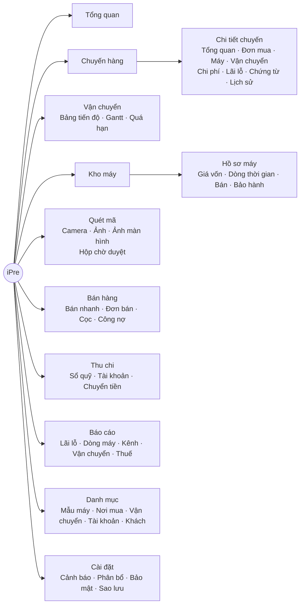
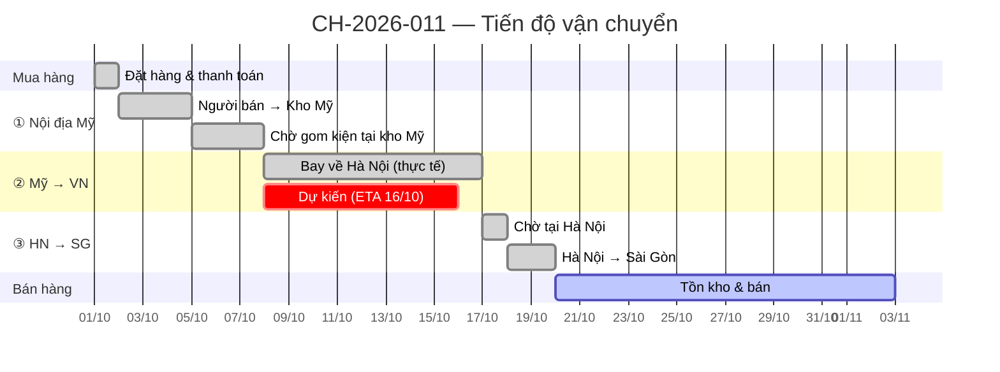

# 05 — Frontend: Màn hình & Trải nghiệm

## 1. Nguyên tắc trải nghiệm

1. **Câu trả lời trước, chi tiết sau.** Mỗi màn hình mở ra là thấy ngay con số quan trọng nhất; bấm vào để đi sâu (tổng quan → chuyến → máy → thành phần giá vốn → chứng từ).
2. **Thao tác theo kiện, không theo máy.** Một cú bấm "Đã nhận" cập nhật mốc cho cả kiện 20 máy.
3. **Tìm mọi thứ trong 1 giây.** Ô tìm kiếm toàn cục `Ctrl/⌘ + K`: gõ hoặc quét IMEI, Serial, mã chuyến, mã đơn, tên khách.
4. **Điện thoại là công cụ hiện trường.** Nhận hàng tại SG (quét serial từng hộp), bán hàng tại chỗ (quét → nhập giá → thấy lãi ngay) làm trên điện thoại.
5. **Không bao giờ chỉ dùng màu để báo lãi/lỗ.** Luôn kèm dấu `+/−` và biểu tượng, đọc được cả khi in đen trắng hoặc ở chế độ tối.
6. **Minh bạch số liệu.** Mọi con số tổng đều bấm vào được để xem nó được cộng từ đâu. Lãi chưa chốt luôn có nhãn **Tạm tính**.

---

## 2. Sơ đồ trang



---

## 3. Bố cục chung

- **Thanh bên trái** (thu gọn được): các mục như sơ đồ trên, có huy hiệu số (vd: Vận chuyển ⚠ 2 kiện quá hạn).
- **Thanh trên:** ô tìm kiếm toàn cục · tỷ giá USD tham khảo hôm nay · nút nhanh **[+ Chuyến hàng] [+ Bán máy]** · chuông thông báo · chuyển sáng/tối.
- **Điện thoại:** thanh điều hướng dưới cùng 5 mục: Tổng quan · Kho · **[Quét]** (nút giữa, to) · Bán · Thêm.
- **Nút "+" ở mọi màn hình** mở form nhập tay tương ứng (phím tắt `N`); mọi ô IMEI/Serial/Part No. có nút 📷 để quét riêng ô đó.

---

## 4. Các màn hình chính

### 4.1. Tổng quan

```
┌──────────────────────────────────────────────────────────────────────────────────────┐
│ iPre   [🔍 Tìm IMEI / Serial / Mã chuyến…  ⌘K]     USD ≈ 26.4xx   [+ Chuyến] [+ Bán] 🔔3│
├───────────┬──────────────────────────────────────────────────────────────────────────┤
│ Tổng quan │  Kỳ: [Tháng này ▾]                                                       │
│ Chuyến    │  ┌────────────┐ ┌────────────┐ ┌────────────┐ ┌────────────┐ ┌──────────┐ │
│ Vận chuyển│  │ VỐN TRONG  │ │ DOANH THU  │ │ LÃI MÁY    │ │ BIÊN LÃI   │ │ TỒN KHO  │ │
│ Kho máy   │  │ HÀNG       │ │ THÁNG      │ │ THÁNG      │ │            │ │ TB       │ │
│ Bán hàng  │  │ 412,5 tr   │ │ 268,0 tr   │ │ +18,4 tr ▲ │ │ 6,9 %      │ │ 12 ngày  │ │
│ Thu chi   │  │ 32 máy     │ │ 9 máy      │ │ 2 tạm tính │ │ ▲0,8 điểm  │ │ ▼3 ngày  │ │
│ Báo cáo   │  └────────────┘ └────────────┘ └────────────┘ └────────────┘ └──────────┘ │
│ Danh mục  │                                                                          │
│ Cài đặt   │  VỐN ĐANG NẰM Ở ĐÂU                                                      │
│           │  Đã đặt   Nội địa Mỹ  Kho Mỹ    Mỹ→VN       Tại HN  HN→SG   Tồn SG        │
│           │  ▓▓ 3     ▓ 2         ▓▓▓ 5     ▓▓▓▓▓▓ 8    ▓ 1     ▓▓ 2    ▓▓▓▓▓▓▓ 11    │
│           │  38,1 tr  21,0 tr     64,2 tr   118,7 tr    9,8 tr  31,5 tr 129,2 tr      │
│           │                                                                          │
│           │  ┌─────────────────────────────────┐ ┌──────────────────────────────────┐│
│           │  │ Doanh thu & lãi 12 tháng        │ │ Lãi theo dòng máy (tháng này)    ││
│           │  │ ▂▃▅▆▄▇█▆▅▇█▇  (cột + đường lãi) │ │ iPhone   ████████████  12,1 tr   ││
│           │  │                                 │ │ Mac      ██████         4,2 tr   ││
│           │  └─────────────────────────────────┘ │ iPad     ███            1,6 tr   ││
│           │                                      │ AirPods  █              0,5 tr   ││
│           │  ⚠ CẦN XỬ LÝ                          └──────────────────────────────────┘│
│           │  • 2 kiện quá ETA (AWB-0001 trễ 2 ngày)  • 3 máy tồn > 30 ngày            │
│           │  • 1 đơn mua còn 2 ngày hết hạn đổi trả  • Doanh thu năm đạt 82% ngưỡng   │
│           │                                                                          │
│           │  CHUYẾN ĐANG CHẠY                                                        │
│           │  CH-2026-012  ●━━━━●━━━━●━━━━◐────○────○   Đang bay · ngày 4/≈8 · 14 máy  │
│           │  CH-2026-013  ●━━━━◐────○────○────○────○   Nội địa Mỹ · 6 máy             │
└───────────┴──────────────────────────────────────────────────────────────────────────┘
```
*(Số liệu trong khung minh hoạ.)*

| Thành phần | Nguồn dữ liệu | Hành động khi bấm |
|---|---|---|
| Thẻ KPI | `v_capital_by_stage`, `v_monthly_pnl`, `v_inventory_aging` | Mở báo cáo tương ứng, giữ nguyên kỳ |
| Thanh "Vốn đang nằm ở đâu" | `v_capital_by_stage` | Mở Kho máy lọc theo trạng thái đó |
| Biểu đồ 12 tháng | `v_monthly_pnl` | Bấm cột → lãi lỗ chi tiết tháng |
| Cần xử lý | Bộ quy tắc cảnh báo | Mở thẳng đối tượng cần xử lý |
| Chuyến đang chạy | `v_batch_summary` + mốc | Mở chi tiết chuyến |

### 4.2. Chuyến hàng — Chi tiết

```
┌──────────────────────────────────────────────────────────────────────────────────────┐
│ ← Chuyến hàng   CH-2026-011   [Đã chốt chi phí ✓]            [Mở lại] [Xuất Excel] ⋯ │
├──────────────────────────────────────────────────────────────────────────────────────┤
│ Tổng quan │ Đơn mua (1) │ Máy (3) │ Vận chuyển (3) │ Chi phí (4) │ Lãi lỗ │ Chứng từ │ │
├──────────────────────────────────────────────────────────────────────────────────────┤
│ DÒNG THỜI GIAN                                                                       │
│ 01/10 ● Đặt hàng ─ 02/10 ● Gửi (USPS) ─ 05/10 ● Kho Mỹ ─ 08/10 ● Bay ─ 17/10 ● Về HN │
│        └─ 1 ngày ─┘         └─ 3,2 ngày ─┘   └─ chờ 2,9 ─┘  └─ 8,3 ngày ─┘  (trễ 1)  │
│ ─ 18/10 ● Rời HN ─ 20/10 ● Nhận SG ─ 23/10 ● Bán #1 ─ 27/10 ● Bán #2                 │
│                                                                                      │
│ CẤU TRÚC GIÁ VỐN (thác nước)            │ KẾT QUẢ                                    │
│ Giá mua        54.040.800  ███████████  │ Tổng vốn           55.943.208              │
│ Nội địa Mỹ        528.000  ▏            │ Doanh thu (2 máy)  51.700.000              │
│ Mỹ → VN         1.224.408  ▎            │ Lãi đã thực hiện   +2.706.128              │
│ HN → SG           150.000  ▏            │ ROI trên vốn bán   5,53 %                  │
│ = Giá vốn      55.943.208               │ Vốn còn đọng       6.979.336 (1 máy)       │
│ Chi phí ngoài giá mua: 3,4% tổng vốn    │ Đối soát: Σ giá vốn = Σ đơn mua + Σ chi ✓  │
└──────────────────────────────────────────────────────────────────────────────────────┘
```

Tab **Vận chuyển** hiển thị Gantt các chặng (kế hoạch vs thực tế):



### 4.3. Vận chuyển — Bảng tiến độ

Dạng **Kanban** theo cột trạng thái, mỗi thẻ là một kiện:

```
 CHỜ GỬI (2)        ① NỘI ĐỊA MỸ (1)    ② MỸ → VN (2)          TẠI HN (1)        ③ HN → SG (1)     ĐÃ NHẬN SG
┌──────────────┐   ┌──────────────┐    ┌─────────────────┐    ┌──────────────┐  ┌──────────────┐
│ CH-013 · 6 m │   │ 1Z99… UPS    │    │ AWB-0007        │    │ AWB-0005     │  │ HNSG-0007    │
│ Kho Mỹ       │   │ ETA 05/11    │    │ Forwarder A     │    │ ⛔ GIỮ HQ    │  │ ETA 04/11    │
│ [Tạo kiện]   │   │ ngày 2/4     │    │ ETA 09/11 · 8 m │    │ 3 ngày       │  │ ⚠ trễ 1 ngày │
└──────────────┘   │ [Đã nhận]    │    │ 118,7 tr        │    │ [Gửi đi SG]  │  │ [Đã nhận]    │
                   └──────────────┘    └─────────────────┘    └──────────────┘  └──────────────┘
```

- Kéo thả thẻ sang cột kế tiếp = "Gửi đi"/"Đã nhận" (hỏi ngày giờ, mặc định bây giờ).
- Bộ lọc: chặng, đơn vị vận chuyển, chỉ quá hạn, chuyến.
- Chế độ xem bảng: so sánh **thời gian trung bình theo đơn vị vận chuyển** (từ `v_item_lead_times`).

### 4.4. Kho máy & Hồ sơ máy

- **Bảng dữ liệu** (TanStack Table): Mã máy · Dòng · Cấu hình · Serial/IMEI · Trạng thái · Chuyến · Giá vốn · Giá mục tiêu · Giá thị trường · **Lãi ước tính** · Tuổi tồn (màu theo nhóm 0–15 / 16–30 / 31–60 / >60).
- Lọc nhanh dạng chip: `Tồn SG` `Đang về` `Đã cọc` `Tồn > 30 ngày` `iPhone` `Mac`…; lưu "góc nhìn" yêu thích.
- Chọn nhiều dòng → thao tác hàng loạt: gán vào kiện, đặt giá mục tiêu, xuất Excel.
- **Hồ sơ máy** (ngăn kéo bên phải): thông tin máy · dòng thời gian dọc M1–M10 · bảng thành phần giá vốn (bấm từng dòng → khoản chi gốc) · lịch sử bán & bảo hành · chứng từ nguồn gốc (hoá đơn mua, AWB…) — **mở được trong 1 chạm khi cần chứng minh nguồn gốc hàng**.

### 4.5. Bán nhanh (tối ưu cho điện thoại)

```
┌───────────────────────────────┐
│ ← Bán máy                     │
│ ┌───────────────────────────┐ │
│ │      [📷 QUÉT IMEI]       │ │
│ └───────────────────────────┘ │
│ iPhone Pro Max 256GB Silver   │
│ SN …PHONE01 · Tồn 3 ngày      │
│ Giá vốn:        32.424.136 ₫  │
│ Giá mục tiêu:   34.500.000 ₫  │
│ ───────────────────────────── │
│ Giá bán   [ 34,5tr          ] │
│ Ship khách[ 30k             ] │
│ Khách     [ 0900… / tên  ▾  ] │
│ Kênh      (FB) Zalo  TikTok … │
│ Thanh toán(CK) Tiền mặt  Cọc  │
│ ───────────────────────────── │
│ LÃI MÁY      +2.045.864 ₫     │
│ Biên lãi      5,93 %  ✓       │
│ ───────────────────────────── │
│ [      XÁC NHẬN BÁN        ]  │
└───────────────────────────────┘
```

- Ô tiền hiểu cách gõ tắt: `34,5tr` → 34.500.000; `30k` → 30.000.
- Lãi hiển thị **ngay khi gõ giá** (gọi `POST /sales/preview`). Nếu giá bán < giá vốn → cảnh báo đỏ, yêu cầu xác nhận lần hai.
- Sau khi bán: tạo phiếu bán/bảo hành (gửi ảnh qua Zalo cho khách), tự ghi sổ thu.

### 4.6. Nhận hàng tại SG (điện thoại)

Mở kiện HN→SG → **quét lần lượt từng hộp**: máy khớp danh sách → ✓ xanh; máy không có trong kiện → ⚠ cảnh báo; quét xong → "Thiếu 1 máy: AirPods Pro SN…" → [Xác nhận đã nhận] (máy thiếu giữ trạng thái đang vận chuyển, mở sự cố). Phác thảo màn hình và các luồng quét khác: [tài liệu 07, mục 5](07-quet-ma-va-nhap-lieu.md).

### 4.6b. Quét mã bằng hình ảnh & nhập liệu tay

Thiết kế đầy đủ ở **[tài liệu 07](07-quet-ma-va-nhap-lieu.md)**:
- Sáu cửa vào: camera trực tiếp, chụp/chọn nhiều ảnh, ảnh chụp màn hình, máy quét USB/Bluetooth, dán văn bản, gõ tay.
- **Hộp chờ duyệt** cho ảnh chụp loạt; mỗi trường có nhãn nguồn (mã vạch / OCR / AI / tay).
- Form nhập tay cho mọi đối tượng + **lưới nhập máy kiểu bảng tính** (dán từ Excel, điền xuống, kiểm IMEI ngay khi gõ).

### 4.7. Thu chi

- Số dư từng tài khoản (thẻ) + tổng tài sản lưu động = tiền + vốn trong hàng.
- Sổ quỹ: lọc theo tài khoản, danh mục, kỳ; bút toán tự sinh có biểu tượng 🔗 dẫn về chứng từ gốc (không sửa trực tiếp được).
- Nút: [+ Khoản chi vận hành] [+ Góp/Rút vốn] [⇄ Chuyển tiền / Đổi ngoại tệ].
- Biểu đồ dòng tiền vào/ra theo tuần.

### 4.8. Báo cáo

| Báo cáo | Hiển thị |
|---|---|
| Lãi lỗ theo kỳ | Bảng kiểu báo cáo kết quả kinh doanh: Doanh thu → Giá vốn → Lãi gộp → Chi phí bán → Chi phí vận hành → Lãi ròng trước thuế; so sánh kỳ trước |
| Theo dòng máy | Số máy bán, doanh thu, lãi, biên lãi, **số ngày bán trung bình** — ma trận "lãi cao / quay nhanh" |
| Theo chuyến | Xếp hạng chuyến theo ROI, theo chu kỳ vốn |
| Theo kênh bán | Facebook / Zalo / TikTok / khách quen… |
| Vận chuyển | Thời gian trung bình từng chặng theo đơn vị vận chuyển; tỉ lệ trễ ETA |
| Tồn kho | Phân bố tuổi tồn; danh sách máy cần xả |
| Doanh thu thuế | Doanh thu theo tháng/quý/năm, số hoá đơn đã xuất, chi phí có chứng từ hợp lệ |

Mọi báo cáo: chọn kỳ, so sánh kỳ trước, xuất Excel.

---

## 5. Thư viện component dùng chung

| Component | Mô tả |
|---|---|
| `MoneyInput` | Nhập VND/USD, hiểu `tr`, `k`; hiển thị định dạng vi-VN |
| `Money` | Hiển thị tiền; tuỳ chọn màu lãi/lỗ + dấu; rút gọn `412,5 tr` |
| `StatusBadge` | Màu + biểu tượng cho trạng thái máy/kiện/chuyến |
| `ProvisionalTag` | Nhãn "Tạm tính" kèm chú thích lý do (còn dự toán / chưa chốt) |
| `Timeline` | Dòng thời gian ngang (chuyến) và dọc (máy), hiển thị số ngày giữa các mốc, đánh dấu trễ |
| `CostWaterfall` | Biểu đồ thác nước cấu trúc giá vốn |
| `CapitalByStageBar` | Thanh "Vốn đang nằm ở đâu" |
| `DataTable` | Bảng lọc/sắp xếp/chọn nhiều/xuất; lưu góc nhìn |
| `Scanner` | Camera trực tiếp + ảnh + máy quét USB; đọc Code 128/UPC/EAN/QR, OCR khi cần; trả về mã đã phân loại (IMEI/Serial/Part No.) |
| `ScanReviewTable` | Hộp chờ duyệt: ảnh thu nhỏ, giá trị đọc được, nhãn nguồn, cảnh báo, sửa trực tiếp |
| `EntryGrid` | Lưới nhập liệu kiểu bảng tính: dán nhiều dòng, `Tab`/`Enter`, `Ctrl+D`, kiểm tra từng ô |
| `FieldSourceBadge` | Nhãn nguồn của trường: mã vạch / OCR / AI / tay |
| `CommandPalette` | Tìm kiếm toàn cục `⌘K` + lệnh nhanh |
| `AttachmentDropzone` | Kéo thả / chụp ảnh chứng từ |

---

## 6. Quy ước hiển thị

| Loại | Định dạng |
|---|---|
| VND | `34.500.000 ₫`; rút gọn trên thẻ KPI: `34,5 tr`, `1,2 tỷ` |
| USD | `$1,199.00` |
| Tỷ giá | `26.400` |
| Ngày | `03/11/2026`; ngày giờ `03/11/2026 14:05` |
| Lãi / lỗ | `+2.045.864 ₫ ▲` (xanh) · `−350.000 ₫ ▼` (đỏ) |
| Thời lượng | `3,2 ngày`; quá hạn: `trễ 2 ngày` (cam/đỏ) |

---

## 7. Kỹ thuật phía giao diện

- **Đọc dữ liệu** bằng Server Components (nhanh, không lộ truy vấn); **ghi** bằng Server Actions với lược đồ Zod dùng chung với API.
- Bộ lọc và kỳ báo cáo lưu trên URL (`nuqs`) → quay lại đúng màn hình đang xem.
- Cập nhật lạc quan (optimistic) cho thao tác nhanh (đánh dấu nhận kiện), có hoàn tác.
- **PWA:** cài lên màn hình chính iPhone/Android; ngoại tuyến chỉ đọc (xem hồ sơ máy đã mở gần đây). **Không cho ghi dữ liệu tài chính khi ngoại tuyến** để tránh xung đột số liệu.
- Chế độ sáng/tối; tương phản đạt chuẩn WCAG AA; điều khiển được bằng bàn phím.
