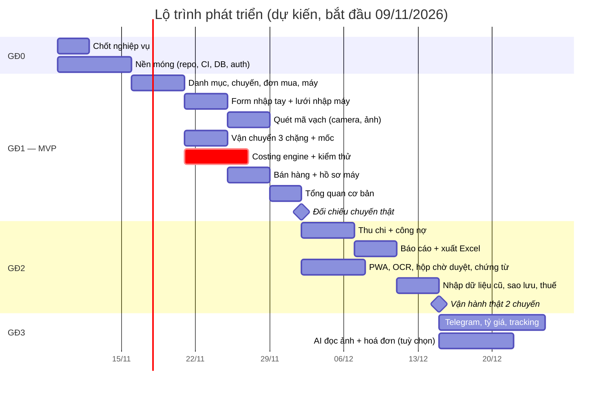

# 06 — Lộ trình, Rủi ro & Góc nhìn pháp lý

## 1. Lộ trình triển khai

| Giai đoạn | Thời lượng | Phạm vi | Tiêu chí nghiệm thu |
|---|---|---|---|
| **GĐ0 — Chốt nghiệp vụ & nền móng** | 1 tuần | Chốt tài liệu 01 và các câu hỏi ở mục 5 · Khởi tạo Next.js, CI, PostgreSQL, migration từ `db/migrations/0001_khoi_tao.sql` · Đăng nhập + 2FA · Bố cục, thanh bên, chế độ tối | Đăng nhập 2FA được; CI xanh; CSDL tạo hoàn toàn từ migration; trang trống chạy trên môi trường thật |
| **GĐ1 — MVP lõi** | 3–4 tuần | Danh mục · Chuyến / Đơn mua / Máy · **Toàn bộ form nhập tay + lưới nhập máy kiểu bảng tính** · **Quét mã vạch bằng camera và từ ảnh** (IMEI/Serial/Part No.), máy quét USB, dán văn bản, `variant_codes` · Kiện 3 chặng + Gửi đi/Đã nhận + mốc tự động · Chi phí + **costing engine** (kèm kiểm thử thuộc tính) · Bán nhanh, cọc · Hồ sơ máy · Tổng quan cơ bản (KPI, vốn theo chặng, cảnh báo trong ứng dụng) | **Nhập lại một chuyến thật đã có trên Excel từ đầu đến cuối: giá vốn và lãi từng máy khớp 0 đồng** (hoặc giải thích được từng chênh lệch) |
| **GĐ2 — Vận hành đầy đủ** | 2–3 tuần | Sổ thu chi, tài khoản, chuyển tiền, công nợ · Báo cáo + xuất Excel · Chứng từ (R2) · PWA · **OCR ảnh chụp màn hình, Hộp chờ duyệt, nhận kiện bằng quét đối chiếu, bộ ảnh mẫu trong CI** · Chốt / mở lại chuyến · Giao diện nhật ký kiểm toán · Nhập dữ liệu cũ từ Excel · Sao lưu tự động · Báo cáo doanh thu thuế + cảnh báo ngưỡng | **Vận hành thật 2 chuyến liên tiếp mà không cần Excel song song** |
| **GĐ3 — Tự động hoá & thông minh** | Liên tục | **AI đọc ảnh khó + hoá đơn → đơn mua** (tuỳ chọn) · Cảnh báo Telegram · Tỷ giá tự động · Đồng bộ tracking qua API · Giá thị trường tham khảo & gợi ý giá bán · Dự báo dòng tiền · Xuất PDF · Tích hợp hoá đơn điện tử (nếu cần) | Theo từng tính năng |

### Tiến độ GĐ0 (cập nhật 04/11/2026)

- [x] Khung Next.js 16 + TypeScript + Tailwind; bố cục thanh bên (máy tính) và thanh điều hướng dưới (điện thoại), chế độ tối theo hệ thống
- [x] Đăng nhập một tài khoản chủ: email + mật khẩu + mã 2 lớp TOTP, chống dò mật khẩu, phiên cookie HttpOnly
- [x] CSDL tạo hoàn toàn từ migration (`db/migrations/0001_khoi_tao.sql`), công cụ migrate có kiểm tra mã băm, Docker Compose cho máy phát triển
- [x] CI (GitHub Actions): kiểm tra kiểu, lint, kiểm thử đơn vị, migration + đối chiếu số liệu ví dụ, build, kiểm thử đầu-cuối
- [x] **Bộ quét mã dùng thử được** (đưa sớm từ GĐ1): camera, ảnh, máy quét USB, dán, nhập tay; xuất CSV / sao chép sang Excel
- [ ] Triển khai lên môi trường thật — chờ bạn chọn nơi triển khai (câu hỏi số 8, mục 5)
- [ ] Chốt nghiệp vụ tài liệu 01 và các câu hỏi ở mục 5

### Tiến độ GĐ1 (cập nhật 04/11/2026)

- [x] **Bộ máy tính giá vốn** (`src/domain/costing/`) — hàm thuần, tiền bằng số nguyên tuyệt đối (bigint), làm tròn như PostgreSQL:
  phân bổ phần dư lớn nhất; thành phần đơn mua làm tròn luỹ kế (khớp cột `total_vnd`); 4 phương pháp phân bổ; chi phí gắn chuyến / đơn mua / kiện / máy;
  hoàn phí (số âm); máy trả người bán; chi phí dự toán → "Tạm tính"; phân bổ giảm giá & chi phí bán theo giá bán; lãi máy, lãi chuyến, ROI, vốn đọng.
  Kiểm thử: thuộc tính (fast-check, hàng nghìn bộ ngẫu nhiên), đối chiếu ví dụ mục 6.1 tài liệu 01 **khớp 0 đồng**, độ phủ ≥ 95% (CI chặn nếu tụt)
- [x] **Lớp dịch vụ giá vốn** (`src/server/costing/service.ts`):
  - `recalculateBatch(es)` đọc CSDL → bộ máy → ghi `item_cost_allocations` theo kiểu so sánh (chỉ thêm/sửa/xoá dòng thay đổi) trong cùng transaction với thao tác sửa dữ liệu; khoá tư vấn chống tính chồng
  - kiện gom máy của nhiều chuyến / đơn mua dính nhiều chuyến → tự gom "cụm" chuyến và tính cùng lúc
  - chuyến đã chốt: kết quả làm đổi bất kỳ dòng giá vốn nào → lỗi `BATCH_FINALIZED`, huỷ cả thao tác sửa
  - `finalizeBatchCosts` (kiểm tra máy đã về SG, hết chi phí dự toán) · `reopenBatchCosts` (bắt buộc lý do) — đều ghi `audit_logs`
  - `recalculateSale`: chia giảm giá & chi phí bán hàng cho từng dòng bán; dòng huỷ không gánh nữa
  - máy trả người bán: cài đặt `costing.returned_item_policy` = `REALLOCATE` (mặc định) / `WRITE_OFF`
  - `npm run costing:check` (CI chạy sau khi nạp dữ liệu ví dụ: bộ máy đọc CSDL phải ra đúng 15 dòng giá vốn đã ghi) · `npm run costing:recalc -- <mã chuyến>`
  - 12 kiểm thử tích hợp với PostgreSQL thật (`npm run test:db`, mỗi ca chạy trong transaction rồi huỷ)
- [x] **Danh mục** (`/danh-muc`, `src/server/catalog/service.ts`, `src/domain/catalog.ts`):
  - mẫu máy → cấu hình (SKU tự gợi ý, cân nặng mặc định) → mã Part No./UPC/EAN; nơi mua; đơn vị vận chuyển (chặng, mẫu link tra vận đơn, số ngày giao); tài khoản tiền
  - tra mã: mã chưa có → hỏi **một lần** để gán cấu hình; bộ quét hiện ngay cấu hình + cân nặng của Part No. vừa đọc, mã lạ có link gán
  - ô số kiểu Việt Nam (`0,6` · `1.199,00` · `$1,199`); lỗi hiện dưới từng ô, không mất dữ liệu đã gõ
  - xoá bị chặn khi đang dùng (máy, đơn mua, kiện, giao dịch); mọi thay đổi ghi `audit_logs`
  - đổi cân nặng mặc định → tự tính lại giá vốn các chuyến liên quan; chuyến đã chốt → chặn
  - còn lại cho GĐ2: danh mục thu chi; khách hàng làm cùng màn hình Bán hàng
- [x] **Chuyến · Đơn mua · Máy** (`/chuyen-hang`, `src/server/purchasing/service.ts`, `src/domain/purchasing.ts`):
  - chuyến: mã tự cấp `CH-năm-số`, tổng hợp vốn / doanh thu / lãi (Tạm tính–Chốt) / ROI / vốn đọng; chốt chi phí & mở lại (bắt buộc lý do); xoá mềm (migration 0002)
  - đơn mua: tỷ giá thực tế gõ kiểu Việt Nam (`26.350`), hạn đổi trả tự tính theo nơi mua, sửa đơn → giá vốn tự tính lại; chuyến đã chốt → chặn
  - **lưới nhập máy kiểu bảng tính**: dán từ Excel/Sheets (nhận cột theo tiêu đề, hoặc tự nhận IMEI/Serial/Part No./giá), gõ tắt cấu hình (`pm 256 sil`), Part No. tự điền cấu hình, Enter xuống dòng (máy quét USB), Ctrl+D điền xuống, mã quét nhầm cột tự chuyển, kiểm Luhn & trùng ngay khi gõ, Σ đơn giá so với Subtotal, cảnh báo khi rời trang chưa lưu
  - lưu cả lưới trong 1 transaction: thêm (kèm mốc "Đã đặt"), sửa, xoá mềm; chống trùng Serial/IMEI toàn hệ thống; máy đã vào kiện / đã bán không xoá được; tính lại giá vốn
- [x] **Kiện 3 chặng** (`/van-chuyen`, `src/server/shipping/service.ts`, `src/domain/shipping.ts`):
  - bảng tiến độ Kanban (Chờ gửi · ① Nội địa Mỹ · ② Mỹ → VN · ③ HN → SG · Đã nhận), thẻ trễ ETA tô đỏ, đếm kiện quá hạn
  - quét máy vào kiện (máy quét USB + Enter, hoặc dán danh sách): mã lạ / đã ở kiện khác cùng chặng / máy đã bán được báo riêng, mã đúng vẫn thêm
  - "Gửi đi" / "Đã nhận" (chọn ngày giờ, nhập bù được) → mốc M2–M7 + trạng thái cho mọi máy; chỉ đi tới không lùi; khách cọc giữ "Khách cọc"; ETA tự tính theo đơn vị vận chuyển
  - giữ hải quan / hết giữ (ghi nhật ký tracking); chuyến tự chuyển "Đang vận chuyển" → "Đã về"
  - đổi máy trong kiện → cước kiện chia lại → giá vốn tính lại (chuyến đã chốt → chặn); kiện đã gửi không bỏ máy / xoá được
- [x] **Chi phí theo chặng** (`src/server/costs/service.ts`, `src/domain/costs.ts`, khối Chi phí ở trang chuyến & trang kiện):
  - gắn vào chuyến / đơn mua / kiện / một máy; cách chia mặc định theo tài liệu 01 mục 5.1 (nội địa: số lượng · Mỹ→VN: cân nặng · bảo hiểm, thuế: giá trị), đổi được
  - USD theo tỷ giá riêng của khoản; số âm = hoàn phí; dự toán / có chứng từ / chưa trả (công nợ); chia tay từng máy theo Serial/IMEI (tổng phải khớp)
  - thêm / sửa / xoá (mềm) → giá vốn tự tính lại; chuyến đã chốt → chặn; còn dự toán → không chốt được
  - cấu trúc giá vốn chuyến theo nhóm A–E + đối soát nhóm A = Σ đơn mua; mỗi khoản hiện "đã phân bổ ✓ n máy"
- [x] **Bán nhanh + cọc + hồ sơ máy** (`/ban-hang`, `/kho`, `src/server/sales/service.ts`, `src/domain/sales.ts`):
  - bán nhanh tối ưu điện thoại: quét IMEI/Serial → giá vốn → gõ giá `34,5tr` / `30k` → **lãi & biên lãi hiện ngay khi gõ**; nhiều máy một đơn (giảm giá, phí chia theo giá bán)
  - kiểm tra: máy đã bán / đã cọc / thất lạc… không bán được (nêu lý do); máy chưa về SG chỉ nhận cọc hoặc tích "bán giao thẳng"; dưới giá vốn phải xác nhận
  - hoàn tất: máy "Đã bán", mốc M8, chụp giá vốn lúc bán, bảo hành shop; tiền vào sổ thu chi (chuyển khoản / tiền mặt / cọc / ghi nợ); khách theo SĐT (tự tạo / tìm lại)
  - đơn cọc: hoàn tất khi máy về; thu thêm; huỷ cọc (máy về đúng trạng thái theo mốc, hoàn một phần / giữ cọc); khách trả lại (máy về tồn kho, hoàn tiền, giữ lịch sử)
  - kho máy: tìm theo Serial / IMEI / Part No. / tên, tồn kho SG kèm tuổi tồn; hồ sơ máy: thành phần giá vốn, dòng thời gian M1–M8, lịch sử bán & bảo hành, nút "Bán máy này"
- [x] **Tổng quan cơ bản** (`/`, `src/server/overview/service.ts`, `src/domain/overview.ts`):
  - kỳ: tháng này / tháng trước / năm nay, so với kỳ trước; thẻ KPI: vốn trong hàng (và phần còn trên đường), doanh thu, lãi máy (đếm máy "tạm tính"), biên lãi, tuổi tồn TB; lãi ròng sau chi phí vận hành khi có
  - "Vốn đang nằm ở đâu" theo 7 chặng — máy khách đã cọc tính ở chỗ máy đang thật sự nằm; bấm chặng → Kho máy lọc `?chang=`
  - "Cần xử lý": kiện giữ hải quan (số ngày), kiện trễ ETA quá số ngày ân hạn, đơn mua sắp hết hạn đổi trả mà còn máy chưa kiểm, máy tồn quá N ngày, đơn cọc đã về SG cần giao, khách còn nợ, doanh thu năm chạm ngưỡng — ngưỡng đọc từ `app_settings`
  - biểu đồ doanh thu & lãi 12 tháng (kèm bảng số), lãi theo dòng máy, tuổi tồn kho, chuyến đang chạy (số máy theo chặng)
- [ ] Nghiệm thu: nhập lại một chuyến thật từ Excel, giá vốn và lãi từng máy khớp 0 đồng — **dời sau GĐ2 theo yêu cầu chủ hàng (05/11/2026)**

### Tiến độ GĐ2 (cập nhật 05/11/2026)

- [x] **Thu chi + công nợ** (`/thu-chi`, `src/server/ledger/service.ts`, `src/domain/ledger.ts`, migration `0005_so_quy.sql`):
  - **bút toán tự sinh**: đơn mua đã trả, cước / chi phí chặng đã trả (số âm = hoàn phí → bút toán thu), chi phí bán hàng đã trả → đúng **một** bút toán liên kết về chứng từ gốc
    (chỉ mục duy nhất chặn ghi trùng), đồng bộ trong cùng transaction khi sửa / bỏ ngày trả / xoá chứng từ; chỉ sửa ở chứng từ gốc. Dữ liệu cũ được ghi bổ sung (`ledger_backfill()`)
  - nhập tay: chi phí vận hành, thu khác, góp / rút vốn, nộp thuế; chuyển tiền / đổi ngoại tệ = 2 bút toán cùng nhóm, không tính vào tổng thu chi toàn sổ
  - tiền theo tiền tệ của tài khoản (tính bằng xu, không sai số), quy đổi VND để báo cáo; tài khoản USD dùng tỷ giá nhập hoặc tỷ giá gần nhất
  - số dư từng tài khoản, sổ một tài khoản có số dư luỹ kế; **đối soát** với sao kê cuối ngày (lưu lịch sử, tuỳ chọn ghi bút toán điều chỉnh)
  - tổng hợp: tiền hiện có, vốn trong hàng, phải thu, phải trả, tài sản lưu động ròng; dòng tiền 12 tuần (kèm bảng số)
  - **công nợ**: phải thu (đơn bán còn nợ theo tuổi nợ, hoàn phí chưa nhận) · phải trả (đơn mua, cước, chi phí bán hàng chưa trả; nút "Đã trả" ghi thẳng vào sổ)
  - danh mục thu chi tự tạo (đánh dấu "vận hành" để trừ vào lãi ròng); danh mục hệ thống không sửa / xoá được
- [x] **Báo cáo + xuất Excel** (`/bao-cao`, `src/server/reports/`, `src/domain/reports.ts`):
  - kỳ: tháng / quý / năm (này, trước) hoặc tự chọn ngày; luôn so với kỳ trước (trọn tháng → cùng số tháng liền trước, còn lại → cùng độ dài)
  - **lãi lỗ** dạng báo cáo kết quả kinh doanh (doanh thu → giá vốn → lãi gộp → chi phí bán → vận hành → lãi ròng trước thuế, % doanh thu, thay đổi),
    theo tháng, chi phí vận hành theo danh mục; đếm máy lãi "Tạm tính"
  - **dòng máy**: số bán, doanh thu, lãi, biên lãi, số ngày bán trung bình (từ khi về SG), đang tồn, xếp loại "lãi cao / quay nhanh" theo trung vị
  - **chuyến**: xếp hạng ROI, vốn còn đọng, chu kỳ vốn · **kênh bán** · **vận chuyển**: ngày đi TB / lâu nhất theo chặng × đơn vị, tỉ lệ trễ ETA, giữ hải quan
  - **tồn kho**: phân bố tuổi tồn, danh sách máy cần xả · **doanh thu thuế**: theo tháng / quý, % ngưỡng doanh thu, đơn chưa ghi số hoá đơn điện tử,
    chi phí có chứng từ hợp lệ
  - **xuất Excel** mọi báo cáo (`/bao-cao/xuat`): tệp .xlsx tự đóng gói (không thêm thư viện), cột tiền / %, dòng tiêu đề cố định, lọc, dòng tổng;
    kiểm bằng openpyxl và LibreOffice
- [x] **Hồ sơ chứng từ nguồn gốc** (mục 3.2; `src/server/attachments/`, `src/domain/attachments.ts`):
  - đính kèm ảnh / PDF vào đơn mua, chuyến, kiện, máy, đơn bán (chụp bằng camera điện thoại); nhận diện định dạng theo nội dung tệp, tối đa 15 MB/tệp;
    khử trùng theo SHA-256; xoá mềm, ghi nhật ký; xem / tải qua `/chung-tu/<id>` (cần đăng nhập)
  - trang máy: **hồ sơ nguồn gốc** gom mọi chứng từ theo hành trình (đơn mua → chuyến → các kiện → máy → đơn bán), báo thiếu hoá đơn mua /
    vận đơn – chứng từ nhập khẩu; `/kho/thieu-chung-tu` liệt kê máy đang trong tay còn thiếu, cảnh báo ngay trên Kho máy
  - kho tệp cục bộ (`ATTACHMENTS_DIR`); thay bằng R2 / S3 khi chốt nơi triển khai
- [x] **Khách hàng** (`/ban-hang/khach-hang`): danh sách (số đơn, đã mua, còn nợ), hồ sơ (máy đã mua, bảo hành, đơn), thêm / sửa (số điện thoại chuẩn hoá, không trùng);
  **ẩn danh hoá** theo yêu cầu (mục 3.3 — Luật 91/2025/QH15): xoá thông tin định danh, giữ giao dịch phục vụ nghĩa vụ thuế; nhật ký không lưu thông tin cá nhân
- [x] **Cài đặt** (`/cai-dat`): ngưỡng cảnh báo, ngưỡng doanh thu thuế + tỷ lệ cảnh báo, chính sách máy trả người bán — chỉ những tham số hệ thống thật sự đọc;
  **tải toàn bộ dữ liệu** (ZIP các CSV, một thời điểm nhất quán, ghi nhật ký)
- [x] **Sổ thuế**: báo cáo doanh thu thuế (Báo cáo › Doanh thu thuế) + ghi / sửa số hoá đơn điện tử trên đơn bán
- [x] **Sao lưu & khôi phục** (rủi ro #4; `npm run backup`, `src/server/backup/`): `pg_dump` + toàn bộ tệp chứng từ trong một gói mã hoá AES-256-GCM
  (khoá `BACKUP_KEY`, sai khoá / tệp bị sửa → từ chối); giữ 30 bản ngày + 12 bản tháng; kiểm tra toàn vẹn; khôi phục trong một transaction, phải xác nhận ghi đè;
  **diễn tập khôi phục tự động trong CI** (khôi phục vào CSDL mới, so từng bảng). Lịch chạy hằng ngày (cron) bật khi có máy chủ thật
- [x] **PWA — cài lên điện thoại**: manifest (lối tắt Bán máy · Quét mã · Kho máy), biểu tượng (thường + maskable + iOS); service worker chỉ lưu đệm
  tài nguyên tĩnh có mã băm và trang "mất kết nối" — **không bao giờ lưu đệm trang / số liệu tài chính**, mất mạng thì báo rõ, có mạng lại tự tải lại
- [x] **Hộp chờ duyệt** (tài liệu 07 mục 5.2; `/quet-ma/hop-cho`, `src/server/scans/`): quét / chụp loạt trên điện thoại (mã vạch + đọc chữ OCR có sẵn
  trong bộ quét) → **Gửi vào hộp chờ duyệt** (gửi lại phiên cũ không tạo trùng) → trên máy tính soát từng dòng (Luhn, Part No. chưa gán cấu hình,
  không phải hàng LL/A, trùng trong hộp, đã có trong hệ thống; nhãn nguồn ▌▌▌ / Aa / ✍), sửa, bỏ, rồi **xác nhận vào đơn mua** (tạo máy — cùng kiểm tra
  với lưới nhập máy, một dòng lỗi thì không tạo gì, giá vốn tự tính lại) hoặc **vào kiện** (nhận hàng theo Serial / IMEI)
- [x] **Nhận kiện bằng quét đối chiếu** (tài liệu 07 mục 5.1; `/van-chuyen/<kiện>/nhan`, `src/domain/receiving.ts`): quét từng hộp khi kiện về, đối chiếu tức
  thì ✓ khớp · ○ còn thiếu · ⚠ ngoài kiện (kèm lý do: thuộc kiện khác / chưa có trong hệ thống). Đủ → nhận; thiếu → phải xác nhận, máy ✓ nhận mốc về,
  máy thiếu giữ trạng thái đang vận chuyển và kiện ghi **sự cố thiếu hàng**; trang kiện có "Đã tìm thấy — nhận bổ sung"; bảng Vận chuyển báo số máy thiếu.
  Chưa làm: gán Serial vừa quét cho máy chưa có Serial cùng cấu hình; đánh dấu **thất lạc** (cần chốt cách ghi lỗ / bồi thường — tài liệu 01 mục 6)
- [x] **Nhật ký thay đổi** (`/cai-dat/nhat-ky`, migration `0006_nhat_ky_chi_them.sql`): mọi thao tác ghi, giá trị trước → sau, lọc theo đối tượng /
  thao tác / ngày, tìm theo Serial / IMEI / mã; "Lịch sử thay đổi" ở trang chuyến, kiện, máy, đơn bán, khách. Nhật ký **chỉ thêm**: CSDL từ chối
  sửa / xoá / truncate. Nhật ký không còn ghi tên, SĐT khách (chỉ mã khách) — dòng cũ đã được làm sạch — để ẩn danh hoá khách theo Luật 91/2025/QH15 trọn vẹn
- [x] **Bot theo dõi vận đơn** (migration `0007_bot_theo_doi_van_don.sql`, `src/domain/tracking.ts`, `src/server/tracking/`): dán link tra cứu
  UPS / USPS / FedEx / DHL (hoặc mã) ở Vận chuyển / Tổng quan → tự nhận hãng (mã UPS kiểm tra số cuối), tạo đơn vị + kiện "Chờ gửi" nếu chưa có, kiểm tra
  ngay. **07:00 và 19:00 giờ VN** mỗi ngày (`npm run tracking` bằng cron `0 0,12 * * *`, hoặc `POST /api/cron/theo-doi-van-don` kèm
  `Authorization: Bearer $CRON_SECRET`) hỏi hãng mọi kiện còn trên đường: ghi **hành trình kiện** (không trùng), hẹn giao + khung giờ của hãng, giờ hãng nhận
  hàng / giao. Báo lên **Tổng quan** (thẻ Bot + "Cần xử lý"): hãng báo đã giao mà chưa nhận kiện, hãng đã nhận hàng mà kiện còn "Chờ gửi", trễ / sự cố,
  hẹn giao muộn hơn dự kiến, 3 ngày không cập nhật, không đọc được vận đơn. Bot **không tự bấm** "Gửi đi" / "Đã nhận" — chỉ điền sẵn giờ hãng báo.
  Chỉ dùng **API chính thức có khoá** (UPS Tracking API: `UPS_CLIENT_ID` + `UPS_CLIENT_SECRET`; hoặc 17TRACK: `TRACK17_API_KEY`) — không cào trang web hãng.
  Phần đọc dữ liệu UPS / 17TRACK viết theo tài liệu API, kiểm bằng dữ liệu mô phỏng; **cần chạy thử với khoá thật** lần đầu
- [x] **Múi giờ khi ghi mốc**: ô "Theo giờ" cạnh mọi ô ngày giờ gửi / nhận (giờ VN, Arizona, Thái Bình Dương, Miền núi, Miền Trung, Miền Đông — tính cả
  giờ mùa hè) → nhập đúng giờ in trên trang hãng, hệ thống tự đổi; mọi nơi vẫn hiển thị giờ VN
- [x] **Mốc "người bán tạo nhãn"** (trước M2): bot tự điền từ hãng hoặc nhập tay; trang kiện hiện "chờ … mới gửi" (đo người bán chậm gửi)
- [ ] Nhập dữ liệu cũ từ Excel — chờ file Excel thật của chủ hàng để dựng đúng cột (hiện đã dán được từ Excel vào lưới nhập máy của từng đơn mua)

**Ưu tiên khi phải cắt giảm:** costing engine và mốc vận chuyển là **không thể cắt**. Có thể dời: biểu đồ nâng cao, Kanban kéo thả (dùng nút bấm thay thế), PWA ngoại tuyến, tracking API.

---

## 2. Rủi ro & biện pháp

| # | Rủi ro | Mức | Biện pháp |
|---|---|---|---|
| 1 | Nhập sai/thiếu tỷ giá, cân nặng → giá vốn sai mà không biết | Cao | Bắt buộc tỷ giá thực tế; cân nặng mặc định theo mẫu máy; nhãn "dự toán"; **đối soát tự động** Σ giá vốn = Σ đơn mua + Σ chi phí |
| 2 | Nhập liệu mất công → bỏ dùng, quay về Excel | Cao | Thao tác theo kiện; lưới nhập kiểu bảng tính, dán từ Excel; quét mã vạch bằng camera/ảnh; gợi ý từ lần nhập trước; bán nhanh trên điện thoại |
| 2b | Quét/OCR đọc sai IMEI, Serial → sai định danh máy | Trung bình | Ưu tiên mã vạch (có số kiểm tra); IMEI kiểm Luhn ở cả trình duyệt, máy chủ và CSDL; trường OCR/AI luôn phải xác nhận; bộ ảnh mẫu kiểm thử tự động |
| 3 | Cách tính mới khác cách tính quen thuộc → mất niềm tin vào số liệu | Trung bình | Nghiệm thu GĐ1 bằng chuyến thật; mọi con số đều "bấm vào xem nguồn" |
| 4 | Mất dữ liệu | Thấp | PITR + `pg_dump` hằng ngày sang nơi khác + xuất toàn bộ; diễn tập khôi phục mỗi quý |
| 5 | Lộ dữ liệu tài chính / khách hàng | Thấp–Trung bình | 2FA, cookie an toàn, bucket riêng tư, cảnh báo đăng nhập lạ, không lưu bí mật trong repo |
| 6 | Pháp luật thuế thay đổi (ngưỡng đã được nâng từ 500 triệu lên 1 tỷ ngay trong năm 2026) | Cao | **Không hard-code** ngưỡng, tỷ lệ: đưa vào `app_settings`; báo cáo thuế tách module riêng |
| 7 | Phình phạm vi (thêm tính năng liên tục) | Trung bình | Bám lộ trình; tính năng mới vào GĐ3 trừ khi chặn việc vận hành |
| 8 | Khoá vào nhà cung cấp | Thấp | PostgreSQL chuẩn, mã nguồn của chủ hàng, xuất dữ liệu bất kỳ lúc nào |

---

## 3. Góc nhìn pháp lý & thuế — những điều hệ thống phải phục vụ

> **Lưu ý:** Phần này nhằm định hướng **thiết kế hệ thống** cho đúng nghĩa vụ pháp lý, không thay thế ý kiến tư vấn cho trường hợp cụ thể. Quy định về thuế hộ kinh doanh đã thay đổi nhiều lần trong 2025–2026; trước khi áp dụng phải đối chiếu **toàn văn và bản hợp nhất** tại thời điểm thực hiện. Thông tin dưới đây được tra cứu đến tháng 11/2026.

### 3.1. Thuế hộ kinh doanh từ năm 2026

| Nội dung | Căn cứ đã tra cứu | Hệ thống phải làm gì |
|---|---|---|
| **Bỏ thuế khoán**, chuyển sang tự kê khai, tự nộp từ 01/01/2026 | Điều 10 Nghị quyết 198/2025/QH15 | Hệ thống trở thành **sổ sách chính thức**: doanh thu từng giao dịch, theo tháng/quý/năm, xuất được cho kế toán |
| Ngưỡng doanh thu **không phải nộp thuế GTGT và TNCN: 1 tỷ đồng/năm** (nâng từ 500 triệu) | Nghị định 68/2026/NĐ-CP, được sửa đổi bởi Nghị định 141/2026/NĐ-CP ngày 29/4/2026 | View `v_yearly_revenue` + cảnh báo khi đạt 80% ngưỡng; ngưỡng là **tham số** `tax.revenue_threshold_vnd` |
| Doanh thu năm **trên 1 tỷ** phải dùng **hoá đơn điện tử có mã của cơ quan thuế**; nếu vượt trong năm thì phải áp dụng, với thời hạn đăng ký 30 ngày kể từ ngày cuối cùng của kỳ tính thuế có doanh thu luỹ kế vượt ngưỡng | Khoản 5 Điều 8 Nghị định 68/2026/NĐ-CP (đã sửa đổi bởi Nghị định 141/2026/NĐ-CP) | Trường `sales.einvoice_no`; báo cáo đơn bán **chưa xuất hoá đơn**; giai đoạn sau có thể kết nối nhà cung cấp hoá đơn điện tử |
| Thuế TNCN có thể tính **theo doanh thu** hoặc **theo thu nhập = doanh thu − chi phí hợp lý, hợp lệ** (phạm vi áp dụng và thuế suất từng phương pháp cần đối chiếu toàn văn) | Hướng dẫn kỳ khai quý I/2026 trên Cổng TTĐT Chính phủ | Mỗi khoản chi có cờ **`has_valid_invoice`** + chứng từ đính kèm → báo cáo "chi phí có chứng từ hợp lệ", giúp so sánh hai phương pháp và chọn phương án có lợi **một cách hợp pháp** |
| Kỳ khai GTGT theo quý nếu doanh thu năm ≤ 50 tỷ | Như trên | Báo cáo doanh thu theo quý |

**Ước lượng quy mô:** với giá bán bình quân khoảng 30 triệu đồng/máy, chỉ khoảng **34 máy/năm** là doanh thu đã chạm 1 tỷ đồng. Nghĩa là hoạt động nhập – bán hàng Apple gần như chắc chắn thuộc diện **phải kê khai, nộp thuế và dùng hoá đơn điện tử**. Vì vậy hệ thống phải được thiết kế như **sổ sách kế toán** ngay từ đầu, không chỉ là công cụ xem lãi.

### 3.2. Chứng minh nguồn gốc hàng hoá nhập khẩu — rủi ro lớn nhất của mô hình

- Theo các nguồn tra cứu, **Nghị định 98/2020/NĐ-CP** (đã được sửa đổi, bổ sung bởi Nghị định 17/2022/NĐ-CP) tại khoản 6 Điều 3 liệt kê các trường hợp bị coi là **hàng nhập lậu**, trong đó có hàng hoá nhập khẩu lưu thông trên thị trường **không có hoá đơn, chứng từ kèm theo** theo quy định; hành vi kinh doanh hàng nhập lậu bị xử phạt theo Điều 15. *(Cần đối chiếu bản hợp nhất hiện hành.)*
- Hệ quả thực tế: một kiện hàng trên đường HN → SG hoặc máy đang bày bán có thể bị kiểm tra; nếu không xuất trình được chứng từ, rủi ro **bị phạt và tịch thu** là có thật.

**Hệ thống đáp ứng bằng "Hồ sơ nguồn gốc" cho từng máy:**
1. Đính kèm theo đơn mua: hoá đơn/biên nhận mua tại Mỹ.
2. Đính kèm theo kiện: vận đơn/AWB, chứng từ thông quan hoặc chứng từ nhập khẩu do bên vận chuyển/nhập khẩu uỷ thác cung cấp, phiếu giao nhận HN → SG.
3. Tra IMEI/Serial → mở **toàn bộ chứng từ của máy trong một chạm** (trên điện thoại).
4. Tuỳ chọn bắt buộc: không cho **chốt chi phí** chuyến khi đơn mua chưa có hoá đơn đính kèm; cảnh báo máy đang tồn kho mà thiếu chứng từ.

> **Khuyến nghị ngoài phần mềm:** làm rõ với đơn vị vận chuyển Mỹ → VN rằng hàng được khai báo hải quan theo hình thức nào và họ cung cấp được chứng từ gì đứng tên ai. Đây là điểm quyết định tính hợp pháp của nguồn hàng — phần mềm chỉ giúp **lưu giữ và xuất trình** chứng cứ, không thay thế được chứng từ hợp lệ.

### 3.3. Dữ liệu cá nhân của khách hàng

- **Luật Bảo vệ dữ liệu cá nhân số 91/2025/QH15**, hiệu lực từ 01/01/2026. Lưu tên, số điện thoại, địa chỉ khách là hoạt động xử lý dữ liệu cá nhân.
- Hệ thống: chỉ thu thông tin cần cho giao hàng và bảo hành; không xuất danh sách khách hàng hàng loạt ra ngoài; bảo mật (2FA, mã hoá khi lưu trữ của dịch vụ CSDL); có chức năng **ẩn danh hoá** khách theo yêu cầu — giữ giao dịch phục vụ nghĩa vụ thuế, xoá thông tin định danh.

### 3.4. Bảo hành và quyền lợi người tiêu dùng

- **Luật Bảo vệ quyền lợi người tiêu dùng 2023** (số 19/2023/QH15): người bán phải thực hiện đúng cam kết đã công bố, trong đó có bảo hành.
- Hệ thống: lưu **thời hạn bảo hành của shop theo từng máy** (`warranty_until`), lịch sử nhận/trả bảo hành, in/gửi phiếu bán – bảo hành cho khách.

---

## 4. Định nghĩa "xong" cho bản MVP

- [ ] Tạo chuyến, đơn mua, thêm máy hàng loạt bằng lưới nhập tay (dán danh sách serial/IMEI từ Excel).
- [ ] Quét IMEI/Serial/Part No. bằng camera và từ ảnh hộp máy; Part No. tự điền cấu hình; IMEI sai số kiểm tra bị chặn.
- [ ] Có form nhập tay cho mọi đối tượng (chuyến, đơn mua, máy, kiện, chi phí, đơn bán, thu chi, khách).
- [ ] Tạo kiện cho 3 chặng, gán máy, "Gửi đi"/"Đã nhận" sinh mốc tự động cho mọi máy.
- [ ] Ghi chi phí theo chặng với 4 phương pháp phân bổ; tổng phân bổ khớp tuyệt đối.
- [ ] Hồ sơ máy hiển thị giá vốn chi tiết và dòng thời gian M1–M8.
- [ ] Bán nhanh: tra máy, xem trước lãi, xác nhận; hỗ trợ cọc.
- [ ] Tổng quan: vốn theo chặng, doanh thu/lãi tháng, tồn kho, cảnh báo kiện quá hạn và máy tồn lâu.
- [ ] Lãi hiển thị đúng nhãn "Tạm tính"/"Chốt".
- [ ] Kiểm thử costing engine đạt ≥ 95% độ phủ; kiểm thử đối chiếu 1 chuyến thật = 0 đồng chênh lệch.
- [ ] Đăng nhập 2FA; sao lưu hằng ngày hoạt động.

---

## 5. Những điều cần bạn xác nhận

Mỗi câu hỏi đã có **giả định mặc định** — nếu không có ý kiến khác, sẽ triển khai theo giả định.

| # | Câu hỏi | Giả định mặc định |
|---|---|---|
| 1 | Hiện đang quản lý bằng gì (Excel / Google Sheets / sổ tay)? Có cần chuyển dữ liệu cũ không? | Có; chuyển 2–3 chuyến gần nhất để đối chiếu |
| 2 | Thanh toán tại Mỹ bằng gì: thẻ Việt Nam, thẻ Mỹ, nhờ người mua hộ, gift card? | Thẻ Việt Nam; nhập tỷ giá thực tế theo sao kê |
| 3 | Forwarder Mỹ → VN tính phí theo kg, theo máy, hay % giá trị? | Theo kg + phụ thu % giá trị |
| 4 | Có mua máy cũ / open box từ cá nhân, eBay không? | Có; quản lý tình trạng máy (`condition`) + ghi chú pin/ngoại hình |
| 5 | Bán qua kênh nào? Có sàn TMĐT (Shopee, TikTok Shop) không? | Mạng xã hội + khách quen; sàn để GĐ3 |
| 6 | Có bán trả góp / cho khách nợ không? | Có ghi nhận công nợ đơn giản |
| 7 | Đã đăng ký hộ kinh doanh chưa? Doanh thu năm dự kiến? | Ưu tiên module thuế & hoá đơn ở GĐ2 |
| 8 | Ưu tiên vận hành "không phải trông" hay "chi phí thấp nhất"? | Dịch vụ quản lý (Vercel + Neon/Supabase + R2) |
| 9 | Tính giá vốn **đích danh từng máy** hay **bình quân**? | **Đích danh** — mỗi máy có serial, chính xác nhất cho hàng giá trị cao |
| 10 | Bạn quét chủ yếu bằng điện thoại, hay sẽ mua thêm máy quét mã vạch cầm tay? | Điện thoại; hệ thống vẫn hỗ trợ máy quét USB/Bluetooth nếu có |
| 11 | Có muốn bật **AI đọc ảnh** (tốn phí theo lượt, ảnh gửi ra dịch vụ ngoài) không? | **Tắt**; chỉ cân nhắc ở GĐ3 sau khi đo hiệu quả mã vạch + OCR |
| 12 | Gửi giúp 10–20 ảnh nhãn hộp thật (iPhone, iPad, Mac, AirPods) và vài ảnh chụp màn hình *Cài đặt › Giới thiệu* | Dùng làm bộ ảnh mẫu để tinh chỉnh bộ nhận dạng |

---

## 6. Bước tiếp theo

1. Đọc [tài liệu 01 — Nghiệp vụ](01-nghiep-vu.md), xác nhận hoặc điều chỉnh công thức và trả lời các câu hỏi ở mục 5.
2. Gửi file Excel của **một chuyến thật** (có thể che thông tin khách hàng) — dùng làm bộ dữ liệu đối chiếu chuẩn cho costing engine.
3. Bắt đầu **GĐ0**: khởi tạo mã nguồn ứng dụng trong repo này.
