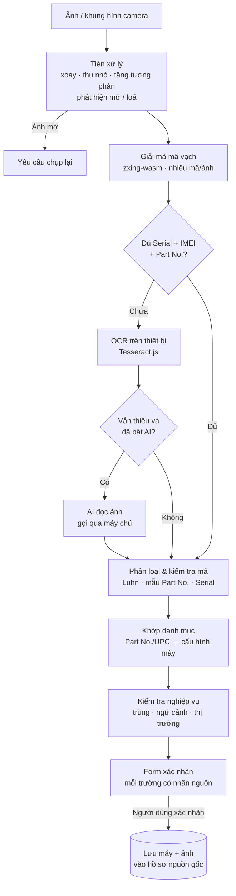
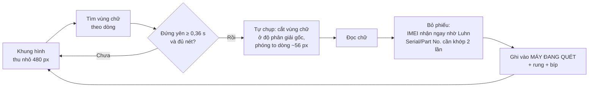

# 07 — Quét mã bằng hình ảnh & Khung nhập liệu tay

> Yêu cầu: dashboard phải **quét được IMEI, Serial và mã máy từ hình ảnh**, đồng thời có **khung nhập liệu để nhập tay** mọi dữ liệu.
> Tài liệu này thiết kế cả hai, vì chúng là hai cửa vào của **cùng một** form xác nhận: quét hay gõ thì dữ liệu đều đi qua cùng một bộ kiểm tra trước khi lưu.

---

## 1. Nguyên tắc

| # | Nguyên tắc | Ý nghĩa |
|---|---|---|
| 1 | **Máy đọc — người duyệt** | Dữ liệu đọc từ ảnh chỉ được lưu sau khi người dùng xác nhận. Ngoại lệ duy nhất: quét trực tiếp khi nhận kiện và mã **khớp đúng** danh sách máy trong kiện. |
| 2 | **Ưu tiên nguồn chính xác nhất** | Mã vạch (có số kiểm tra) → Nhận dạng chữ OCR → AI đọc ảnh. Gõ tay luôn được, mọi trường luôn sửa được. |
| 3 | **Xử lý ngay trên thiết bị** | Giải mã vạch và OCR chạy trong trình duyệt: nhanh, không tốn phí, ảnh không rời máy. Dịch vụ AI bên ngoài chỉ là **tuỳ chọn, tắt mặc định**. |
| 4 | **Không tin dữ liệu từ trình duyệt** | Máy chủ kiểm tra lại toàn bộ (IMEI hợp lệ, trùng lặp, ngữ cảnh) và CSDL chặn lần cuối bằng ràng buộc. |
| 5 | **Ảnh là chứng từ** | Ảnh hộp máy đã xác nhận được lưu kèm hồ sơ máy — một phần của "hồ sơ nguồn gốc" (tài liệu 06, mục 3.2). |

---

## 2. Đọc được gì, từ ảnh nào

| Nguồn ảnh | Thông tin thường có | Cách đọc | Độ tin cậy |
|---|---|---|---|
| **Nhãn sau hộp máy** (iPhone, iPad, Watch, AirPods, Mac) | Mô tả cấu hình, **Part No. (mã máy)**, **Serial**, **IMEI/IMEI2** (máy có mạng di động), UPC/EAN | Mã vạch 1D (Code 128, UPC/EAN); một số nhãn có mã 2D | ⭐⭐⭐ Rất cao |
| **Ảnh chụp màn hình** *Cài đặt › Cài đặt chung › Giới thiệu* | Tên máy, Số kiểu máy (Part No.; chạm vào để hiện số hiệu A…), Serial, IMEI, IMEI2, EID | OCR chữ | ⭐⭐⭐ Cao (ảnh màn hình rất nét) |
| **Màn hình quay số `*#06#`** | IMEI, EID | OCR (và mã vạch nếu có hiển thị) | ⭐⭐⭐ Cao |
| **Mặt dưới MacBook / trong nắp hộp sạc AirPods** | Serial khắc laser, chữ rất nhỏ | OCR (khó) → AI (tuỳ chọn) | ⭐ Thấp → nên quét hộp |
| **Hoá đơn, email xác nhận đơn hàng** (ảnh chụp màn hình/PDF) | Người bán, mã đơn, ngày, dòng hàng, đơn giá, thuế, đôi khi cả serial | OCR + quy tắc → AI (tuỳ chọn) | ⭐⭐ Trung bình — luôn duyệt |
| **Ảnh forwarder chụp tại kho Mỹ** | Nhãn hộp như trên | Như nhãn hộp | ⭐⭐⭐ — **lấy được serial trước khi hàng về** |

> Bố cục nhãn khác nhau theo đời máy và thị trường. Bộ quy tắc ở mục 4.3 sẽ được tinh chỉnh bằng **bộ ảnh mẫu thật** (mục 9) ngay từ GĐ0–GĐ1, không dựa trên giả định.

---

## 3. Sáu cửa vào dữ liệu

| Cửa vào | Dùng khi | Thiết bị |
|---|---|---|
| 📷 **Quét trực tiếp bằng camera** | Nhận kiện hàng loạt tại SG, bán tại chỗ, tra cứu nhanh | Điện thoại |
| 🖼️ **Chụp / chọn nhiều ảnh** | Chụp loạt 20 hộp rồi duyệt sau; ảnh forwarder gửi qua Zalo | Điện thoại, máy tính |
| 📱 **Ảnh chụp màn hình** | Máy cũ/open box không còn hộp; kiểm tra máy khách mang tới | Điện thoại, máy tính |
| 🔫 **Máy quét mã vạch USB/Bluetooth** | Bàn nhận hàng: quét liên tục, nhanh nhất | Máy tính |
| 📋 **Dán văn bản** | Danh sách serial từ email, Excel, tin nhắn | Máy tính |
| ⌨️ **Gõ tay** | Mọi trường hợp còn lại — xem mục 6 | Mọi thiết bị |

---

## 4. Quy trình xử lý ảnh



### 4.1. Tiền xử lý
- Xoay theo thông tin hướng ảnh (EXIF); thu nhỏ cạnh dài về ~2.000 px (đủ nét cho mã vạch, xử lý nhanh); chuyển ảnh xám, tăng tương phản.
- **Phát hiện ảnh mờ / loá sáng** → báo ngay "Chụp lại, giữ máy song song với nhãn" thay vì đọc sai.
- Ảnh HEIC từ iPhone: Safari tự chuyển khi tải lên; ảnh HEIC chép vào máy tính được chuyển định dạng trước khi xử lý.

### 4.2. Giải mã mã vạch
- **zxing-wasm** (thư viện ZXing biên dịch WebAssembly): chạy được trên Safari iPhone, đọc **nhiều mã trong một ảnh**, tự thử các góc xoay; hỗ trợ Code 128, UPC-A, EAN-13, QR, DataMatrix.
- Dùng thêm `BarcodeDetector` có sẵn của trình duyệt khi có (Chrome Android) để nhanh hơn.
- Chạy trong **Web Worker** để giao diện không bị khựng khi quét liên tục.

### 4.3. Phân loại mã — quy tắc nhận diện

Một nhãn hộp có 3–5 mã vạch đứng cạnh nhau; hệ thống phải tự biết mã nào là gì:

| Loại | Quy tắc | Kiểm tra |
|---|---|---|
| **IMEI** | Đúng 15 chữ số | **Thuật toán Luhn** (chữ số cuối là số kiểm tra) — gõ nhầm/đọc nhầm 1 chữ số là bị phát hiện |
| **EID** (eSIM) | 32 chữ số | Lưu ghi chú, không dùng làm định danh chính |
| **UPC-A / EAN-13** | 12 / 13 chữ số | Số kiểm tra chuẩn GS1 → tra cấu hình máy |
| **Part No. (mã máy)** | Mẫu `XXXXX` + mã thị trường + `/A`, ví dụ `…LL/A`; mã vạch có thể kèm tiền tố `1P` | Tách hậu tố thị trường (`LL/A` = hàng Mỹ, `VN/A` = hàng Việt Nam…) → tra cấu hình |
| **Serial** | 10 hoặc 12 ký tự chữ-số in hoa; mã vạch có thể kèm tiền tố `S` | Không có số kiểm tra → **ưu tiên đọc từ mã vạch**; nếu từ OCR phải duyệt kỹ |

*Tiền tố `1P` và `S` là "định danh dữ liệu" theo chuẩn ghi nhãn ANSI MH10.8.2, thường thấy trên nhãn Apple dưới dạng "(1P) Part No." và "(S) Serial No.". Quy tắc tách tiền tố sẽ được xác nhận lại trên ảnh mẫu thật.*

```ts
// src/server/domain/identifiers.ts — dùng chung cho trình duyệt và máy chủ
export type CodeKind = "IMEI" | "SERIAL" | "PART_NUMBER" | "UPC" | "EAN" | "EID" | "UNKNOWN";

export function isValidImei(s: string): boolean {
  if (!/^\d{15}$/.test(s)) return false;
  let sum = 0;
  for (let i = 0; i < 15; i++) {
    let d = s.charCodeAt(i) - 48;
    if (i % 2 === 1) { d *= 2; if (d > 9) d -= 9; }   // nhân đôi các vị trí chẵn (đếm từ 1)
    sum += d;
  }
  return sum % 10 === 0;
}

const PART = /^[A-Z0-9]{5}[A-Z]{1,2}\/A$/;
const SERIAL = /^(?:[A-Z0-9]{10}|[A-Z0-9]{12})$/;

export function classifyCode(raw: string): { kind: CodeKind; value: string } {
  const t = raw.trim().toUpperCase().replace(/\s+/g, "");
  if (isValidImei(t))                             return { kind: "IMEI", value: t };
  if (/^\d{32}$/.test(t))                         return { kind: "EID", value: t };
  if (isValidUpcA(t))                             return { kind: "UPC", value: t };
  if (isValidEan13(t))                            return { kind: "EAN", value: t };
  if (t.startsWith("1P") && PART.test(t.slice(2))) return { kind: "PART_NUMBER", value: t.slice(2) };
  if (PART.test(t))                               return { kind: "PART_NUMBER", value: t };
  if (t.startsWith("S") && SERIAL.test(t.slice(1))) return { kind: "SERIAL", value: t.slice(1) };
  if (SERIAL.test(t))                             return { kind: "SERIAL", value: t };
  return { kind: "UNKNOWN", value: t };
}
```

**Đã chạy thử nguyên mẫu bộ phân loại** với các trường hợp: IMEI hợp lệ ✓ / IMEI sai số kiểm tra ✗, Part No. có và không có tiền tố `1P`, mã thị trường `LL/A` và `VN/A`, serial 10 và 12 ký tự có/không có tiền tố `S`, UPC, EAN, EID, chuỗi rác — tất cả cho kết quả đúng.

### 4.4. OCR (khi mã vạch không đủ)
- **Tesseract.js** chạy trên thiết bị, giới hạn bảng ký tự `A–Z 0–9 /` để giảm nhầm.
- Tìm giá trị cạnh các **nhãn neo** bằng cả tiếng Anh và tiếng Việt: `Serial No.`, `Serial Number`, `Số sê-ri`, `IMEI`, `IMEI2`, `Part No.`, `Model Number`, `Số kiểu máy`, `EID`.
- **Tự sửa ký tự dễ nhầm cho IMEI:** `O/D→0`, `I/L→1`, `S→5`, `B→8`, `Z→2`, rồi kiểm Luhn — chỉ tự sửa khi ra **đúng một** kết quả hợp lệ (đã thử: `3SOOOOOOOOOOOO6` → `350000000000006` ✓; chuỗi sai số kiểm tra → không tự sửa).
- **Serial:** không tự sửa; tô vàng các ký tự dễ nhầm (`0/O`, `1/I`, `5/S`, `8/B`) để người dùng soát với ảnh.

### 4.5. AI đọc ảnh (tuỳ chọn) — xem mục 8.

### 4.6. Khớp danh mục & kiểm tra nghiệp vụ
| Kiểm tra | Kết quả |
|---|---|
| Part No./UPC đã có trong `variant_codes` | Tự điền **dòng máy, dung lượng, màu, cân nặng** |
| Mã chưa từng gặp | Hỏi **một lần**: "Mã `…` là cấu hình nào?" → chọn hoặc tạo cấu hình → hệ thống ghi nhớ cho mọi lần sau |
| Hậu tố thị trường khác `LL/A` trong chuyến hàng Mỹ | ⚠ Cảnh báo vàng (có thể là máy không phải hàng Mỹ) |
| IMEI/Serial đã tồn tại | ⛔ Đỏ, hiện máy đã có — có thể là quét lại, hoặc nhầm hàng |
| Ngữ cảnh "nhận kiện": máy không có trong kiện | ⚠ "Không có trong kiện HNSG-0007" — có thể gửi nhầm kiện |
| Ngữ cảnh "bán": máy không ở trạng thái bán được | ⛔ Chặn, nêu lý do (đã bán, đang bảo hành…) |
| Mã vạch và OCR/AI đọc ra hai giá trị khác nhau | Lấy theo mã vạch, ⚠ báo để người dùng soát |

### 4.7. Nhãn nguồn của từng trường
Mỗi ô trong form xác nhận hiện rõ **giá trị được lấy từ đâu**:

| Nhãn | Nguồn | Có cần bấm xác nhận riêng? |
|---|---|---|
| `▌▌▌ Mã vạch` (xanh) | Giải mã mã vạch + qua kiểm tra | Không |
| `Aa OCR` (vàng) | Nhận dạng chữ | **Có** |
| `✨ AI` (vàng) | AI đọc ảnh | **Có** |
| `✍ Tay` | Người dùng gõ | — |

Nguồn của từng trường được lưu trong `scan_captures.extracted.sources` để truy vết về sau.

---

## 5. Các luồng sử dụng

### 5.1. Nhận kiện tại SG bằng quét trực tiếp (điện thoại)

```
┌────────────────────────────────┐
│ ← Nhận kiện HNSG-0007    5/6 ✓ │
│ ┌────────────────────────────┐ │
│ │    ┌──────────────────┐    │ │
│ │    │ ▌▌▌ ▌▌ ▌▌▌ ▌ ▌▌▌ │    │ │  ← khung ngắm, tự đọc liên tục
│ │    └──────────────────┘    │ │
│ │  [💡 Đèn]   [🔍 Phóng to]  │ │
│ └────────────────────────────┘ │
│ ✓ iPhone Pro Max 256 Silver    │
│   SN …Q7Y9KD · IMEI …000006    │
│ ✓ iPad Air 11 128 Blue         │
│ ⚠ Không có trong kiện: SN …X9  │
│ ○ Còn thiếu: AirPods Pro       │
│ ────────────────────────────── │
│ [ ⌨ Nhập tay ] [Xác nhận nhận] │
└────────────────────────────────┘
```

- Mỗi hộp quét xong: tiếng "bíp" + rung (trên thiết bị hỗ trợ), dòng chuyển ✓; cùng một mã trong 3 giây bị bỏ qua (chống đọc lặp).
- Máy chưa có serial trong hệ thống (đặt hàng chưa biết serial): hệ thống gợi ý **gán serial vừa quét vào máy cùng cấu hình còn trống** trong kiện.
- Bấm "Xác nhận nhận": các máy ✓ chuyển "Tồn kho SG"; máy còn thiếu giữ nguyên trạng thái đang vận chuyển và mở **sự cố thiếu hàng**.

### 5.2. Chụp loạt ảnh → "Hộp chờ duyệt" (điện thoại chụp, máy tính duyệt)

Chụp nhanh 20 hộp trên điện thoại (hoặc tải lên ảnh forwarder gửi) → ảnh vào **Hộp chờ duyệt** → mở trên máy tính để duyệt hàng loạt:

```
HỘP CHỜ DUYỆT (12)     Gán vào: [Đơn mua W123456789 ▾]              [✓ Xác nhận các dòng hợp lệ (9)]
┌──────┬──────────────────────┬────────────────┬────────────────────┬──────────────┬─────────────────────┐
│ Ảnh  │ Cấu hình             │ Serial         │ IMEI 1             │ Part No.     │ Trạng thái          │
├──────┼──────────────────────┼────────────────┼────────────────────┼──────────────┼─────────────────────┤
│ [▣]  │ iPhone Pro Max 256   │ F2LXQ7Y9KD ▌▌▌ │ 350000000000006 ▌▌▌│ MDEM1LL/A ▌▌▌│ ✓ Hợp lệ            │
│ [▣]  │ iPad Air 11 128      │ H7K2…      Aa⚠ │ —                  │ MDEM2LL/A ▌▌▌│ ⚠ Soát serial (OCR) │
│ [▣]  │ ? (mã mới)           │ G9…        ▌▌▌ │ 35…            ▌▌▌ │ MXYZ9ZA/A ▌▌▌│ ⚠ Gán cấu hình ·    │
│      │                      │                │                    │              │   không phải LL/A   │
│ [▣]  │ —                    │ —              │ —                  │ —            │ ✖ Ảnh mờ — chụp lại │
└──────┴──────────────────────┴────────────────┴────────────────────┴──────────────┴─────────────────────┘
Bấm vào một dòng → ảnh phóng to, vùng mã vạch được khoanh; sửa trực tiếp từng ô; phím ↑↓ chuyển dòng.
```

### 5.3. Tra cứu nhanh
Nút **[Quét]** giữa thanh điều hướng điện thoại (hoặc phím `S`): quét bất kỳ mã nào → mở thẳng **hồ sơ máy** (giá vốn, dòng thời gian, chứng từ nguồn gốc, bảo hành).

### 5.4. Bán hàng
Quét → form bán nhanh đã điền sẵn máy và giá vốn (xem tài liệu 05, mục 4.5).

### 5.5. Hoá đơn → đơn mua (GĐ3, cần bật AI)
Chụp/tải hoá đơn hoặc email xác nhận đơn hàng → AI trích xuất người bán, mã đơn, ngày, các dòng hàng, đơn giá, thuế → **điền sẵn form đơn mua** để duyệt, sửa rồi lưu.

---

## 6. Khung nhập liệu tay

### 6.1. Nguyên tắc
1. **Mọi thứ quét được đều gõ tay được** và mọi trường quét ra đều sửa được.
2. **Một form cho mọi cửa vào:** form nhập tay chính là form xác nhận sau khi quét — không có hai luồng dữ liệu khác nhau.
3. **Nhanh như bảng tính, chặt như phần mềm kế toán:** lưới nhập liệu cho nhiều dòng, nhưng kiểm tra ngay từng ô.
4. **Không mất công nhập:** nháp tự lưu; có hoàn tác sau khi lưu.

### 6.2. Các form và trường dữ liệu

Ký hiệu: **\*** bắt buộc · *(mặc định)*.

| Form | Trường |
|---|---|
| **Chuyến hàng** | Mã chuyến\* *(tự sinh `CH-2026-012`)* · Tên · Tỷ giá dự kiến · Ghi chú |
| **Đơn mua** | Chuyến\* · Nơi mua\* *(gợi ý từ danh mục)* · Mã đơn · Ngày đặt\* *(hôm nay)* · Tiền tệ *(USD)* · Subtotal\* · Sales tax · Phí ship người bán · Giảm giá · **Tỷ giá thực tế\*** *(gợi ý tỷ giá hôm nay)* · Phí chuyển đổi ngoại tệ (VND) · Tài khoản thanh toán · Ngày thanh toán · Hạn đổi trả *(tự tính theo nơi mua)* · **Lưới máy** (mục 6.3) · Đính kèm hoá đơn |
| **Máy** (dòng trong lưới hoặc form riêng) | Cấu hình\* *(gõ tắt hoặc quét Part No.)* · Đơn giá\* · Serial 📷 · IMEI 1 📷 · IMEI 2 📷 · Part No. 📷 · Số hiệu kiểu máy · Tình trạng *(Mới nguyên seal)* · Cân nặng *(theo cấu hình)* · Giá mục tiêu · Đã kiểm iCloud · Ghi chú |
| **Kiện / chặng** | Chặng\* · Đơn vị vận chuyển\* · Mã tracking 📷 · Mã bill/AWB · Ngày gửi · ETA *(= ngày gửi + thời gian giao mặc định của đơn vị)* · Cân nặng tính cước · Máy trong kiện\* *(chọn từ danh sách hoặc quét)* |
| **Chi phí** | Loại\* · Gắn vào\* (chuyến / đơn mua / kiện / máy) · Số tiền\* · Tiền tệ · Tỷ giá · Cách phân bổ *(theo loại chi phí)* · Là dự toán? · Có chứng từ hợp lệ? · Ngày phát sinh\* · Tài khoản · Đã trả? · Đính kèm |
| **Đơn bán** | Máy\* *(quét / tìm)* · Giá bán\* · Khách *(tìm theo SĐT hoặc thêm nhanh)* · Kênh · Giảm giá · Chi phí bán (ship, COD…) · Thanh toán (CK / tiền mặt / cọc) · Bảo hành *(số tháng theo cài đặt)* · Số hoá đơn điện tử |
| **Thu chi** | Loại\* (Thu / Chi / Chuyển tiền) · Tài khoản\* · Số tiền\* · Danh mục\* · Ngày\* *(hôm nay)* · Đối tác · Ghi chú · Đính kèm |
| **Khách hàng** | Họ tên\* · SĐT *(kiểm tra định dạng, chống trùng)* · Zalo / Facebook · Địa chỉ giao hàng |
| **Mốc thời gian (nhập bù)** | Chọn kiện → nhập ngày gửi / ngày nhận trong quá khứ — dùng khi chuyển dữ liệu chuyến cũ |
| **Danh mục** | Mẫu máy, cấu hình (kèm các mã Part No./UPC), nơi mua, đơn vị vận chuyển, tài khoản, danh mục thu chi |

### 6.3. Lưới nhập máy kiểu bảng tính (đơn mua nhiều máy)

```
ĐƠN MUA   Apple Store · W123456789 · 01/10/2026 · USD · Tỷ giá [26.400]          Subtotal [$2,047.00]
┌───┬────────────────────────┬──────────┬──────────────┬───────────────────┬─────────────┬──────────┬──────┐
│ # │ Cấu hình (gõ tắt/quét) │ Đơn giá  │ Serial    📷 │ IMEI 1         📷 │ Part No. 📷 │ Tình trạng│ Kg  │
├───┼────────────────────────┼──────────┼──────────────┼───────────────────┼─────────────┼──────────┼──────┤
│ 1 │ iPhone Pro Max 256 Slv │ 1,199.00 │ F2LXQ7Y9KD   │ 350000000000006 ✓ │ MDEM1LL/A   │ Mới seal │ 0,6  │
│ 2 │ iPad Air 11 128 Blue   │   599.00 │              │ (Wi-Fi: để trống) │ MDEM2LL/A   │ Mới seal │ 0,9  │
│ 3 │ AirPods Pro            │   249.00 │              │ —                 │ MDEM3AM/A   │ Mới seal │ 0,3  │
│ + │ Dán nhiều dòng từ Excel (Ctrl+V) · hoặc quét liên tục để thêm dòng                                │
└───┴────────────────────────┴──────────┴──────────────┴───────────────────┴─────────────┴──────────┴──────┘
Σ đơn giá $2,047.00 = Subtotal ✓      Giá mua quy đổi: 54.040.800 ₫          [Lưu nháp]  [Lưu đơn mua ⌘↵]
```

- **Dán từ Excel/Google Sheets:** nhận nhiều dòng, nhiều cột; tự nhận diện cột nào là IMEI/Serial/Part No. bằng bộ phân loại ở mục 4.3.
- `Tab` / `Enter` di chuyển như bảng tính; `Ctrl+D` điền xuống (vd: cùng đơn giá, cùng cấu hình); nhân bản dòng.
- Ô IMEI kiểm Luhn ngay khi gõ đủ 15 số; ô cấu hình gợi ý tức thì; dòng lỗi tô đỏ kèm lý do.
- Thanh tổng kết so Σ đơn giá với Subtotal của hoá đơn — lệch là thấy ngay.

### 6.4. Ô nhập thông minh

| Loại ô | Cách gõ được hiểu | Ghi chú kỹ thuật |
|---|---|---|
| Tiền VND | `34,5tr` → 34.500.000 · `30k` → 30.000 · `1,2ty` → 1.200.000.000 | Luôn hiển thị lại số đầy đủ để kiểm tra |
| Tiền USD | `1199` · `$1,199.00` | Tối đa 2 chữ số thập phân |
| Ngày | `hôm nay` · `hqua` · `15/10` · `+3` (3 ngày sau) | Hiển thị `dd/mm/yyyy`, lưu kèm múi giờ |
| Cấu hình máy | `pm 256 sil` → iPhone Pro Max 256GB Silver | Tìm mờ trên danh mục + mã Part No. |
| IMEI | Chỉ nhận số | Bàn phím số trên điện thoại (`inputmode="numeric"`), kiểm Luhn |
| Serial | Tự in hoa, không tự sửa chính tả | `autocapitalize="characters"`, tắt autocorrect và kiểm tra chính tả |
| Khách hàng | Gõ SĐT hoặc tên | Không có → "Thêm nhanh" ngay trong ô |
| Mọi ô mã | Nút 📷 bên cạnh | Mở quét cho riêng ô đó |

### 6.5. Phím tắt

| Phím | Tác dụng |
|---|---|
| `⌘/Ctrl + K` | Tìm kiếm toàn cục / lệnh nhanh |
| `N` | Tạo mới (theo màn hình đang xem) |
| `S` | Mở quét mã |
| `⌘/Ctrl + Enter` | Lưu |
| `Esc` | Đóng / huỷ |
| `Tab`, `Shift + Tab` | Ô kế tiếp / ô trước |
| `Enter` (trong lưới) | Xuống dòng dưới |
| `Ctrl + D` | Điền xuống |
| `⌘/Ctrl + Z` | Hoàn tác |

**Máy quét mã vạch USB/Bluetooth** hoạt động như bàn phím gõ rất nhanh rồi nhấn Enter. Hệ thống nhận ra chuỗi ký tự đến dồn dập (< 30 ms/ký tự) là một lần quét, đưa qua bộ phân loại và điền vào đúng ô — kể cả khi con trỏ không nằm ở ô đó.

### 6.6. Chống sai & không mất dữ liệu
- **Kiểm tra hai tầng:** lỗi cứng (chặn lưu: IMEI sai, trùng serial, thiếu trường bắt buộc) và cảnh báo mềm (cho lưu: subtotal lệch, mã thị trường lạ, giá bán dưới giá vốn).
- **Tóm tắt trước khi lưu** với đơn có nhiều dòng: "12 máy · 2 cảnh báo · 0 lỗi".
- **Nháp tự lưu** trên thiết bị: lỡ đóng tab vẫn khôi phục được.
- **Hoàn tác 10 giây** sau khi lưu; sau đó mọi sửa đổi đi qua nhật ký kiểm toán.
- Bút toán thu chi do hệ thống tự sinh **không sửa tay** — muốn sửa thì sửa chứng từ gốc (đơn mua, chi phí, đơn bán) để số liệu luôn nhất quán.

---

## 7. Kiến trúc kỹ thuật

| Thành phần | Công nghệ | Chạy ở |
|---|---|---|
| Camera | `getUserMedia` (camera sau, độ phân giải cao, đèn flash khi thiết bị hỗ trợ) | Trình duyệt |
| Giải mã mã vạch | **zxing-wasm** + `BarcodeDetector` (khi có), trong Web Worker | Trình duyệt |
| OCR | **Tesseract.js** (WebAssembly) | Trình duyệt |
| Phân loại & kiểm tra mã | `identifiers.ts` (mục 4.3) — **cùng một mã nguồn** cho cả hai phía | Trình duyệt + máy chủ |
| Lưu ảnh | Tải thẳng lên R2 bằng URL ký có thời hạn | Trình duyệt → R2 |
| Kiểm tra lại, lưu dữ liệu | Services + ràng buộc CSDL | Máy chủ |
| AI đọc ảnh (tuỳ chọn) | Claude API qua SDK chính thức `@anthropic-ai/sdk` | **Chỉ máy chủ** (khoá API không bao giờ xuống trình duyệt) |

**Yêu cầu môi trường:** camera trên web chỉ hoạt động qua **HTTPS**; người dùng cấp quyền camera một lần; hoạt động trên Safari iPhone và khi cài ứng dụng lên màn hình chính (PWA).

**API bổ sung (`/api/v1`):**

| Phương thức & đường dẫn | Chức năng |
|---|---|
| `POST /scans` | Gửi kết quả quét (mã vạch, OCR, khoá ảnh) → máy chủ kiểm tra lại, trả về đề xuất điền form |
| `GET /scans?status=PENDING_REVIEW` | Hộp chờ duyệt |
| `PATCH /scans/:id` | Sửa giá trị đã đọc |
| `POST /scans/:id/confirm` | Xác nhận: tạo máy mới trong đơn mua / gán vào máy có sẵn / đánh dấu nhận trong kiện |
| `POST /scans/:id/discard` | Bỏ qua |
| `POST /scans/:id/ai-read` | Gọi AI đọc ảnh (chỉ khi đã bật trong Cài đặt) |
| `GET /variants/resolve?code=` | Part No./UPC → cấu hình máy |
| `POST /variant-codes` | Ghi nhớ mã mới cho một cấu hình |
| `POST /purchase-orders/:id/items/bulk` | Lưu cả lưới máy trong một transaction |
| `POST /purchase-orders/extract-invoice` | Hoá đơn → bản nháp đơn mua (AI, GĐ3) |

---

## 8. AI đọc ảnh — tuỳ chọn, tắt mặc định

**Khi nào cần:** chỉ cho phần khó mà mã vạch và OCR không giải quyết được — serial khắc laser, ảnh chụp kém, và đọc **hoá đơn thành đơn mua**. Ước tính dưới 10–20% số ảnh cần đến AI.

**Mô hình:** mặc định `claude-opus-5-5`. Nếu muốn giảm chi phí, bạn có thể chuyển sang mô hình rẻ hơn (`claude-haiku-5-5`, rẻ hơn khoảng 40 lần) — nên quyết định **sau khi đo độ chính xác của cả hai trên bộ ảnh mẫu** (mục 9). Mô hình là một tham số trong Cài đặt (`scan.ai_model`), không phải sửa mã.

```ts
// src/server/integrations/ai-label-reader.ts — phác thảo, CHỈ chạy trên máy chủ
import Anthropic from "@anthropic-ai/sdk";
import { z } from "zod";
import { zodOutputFormat } from "@anthropic-ai/sdk/helpers/zod";

const LabelSchema = z.object({
  product_description: z.string().nullable(),
  part_number: z.string().nullable(),
  model_number: z.string().nullable(),
  serial_number: z.string().nullable(),
  imeis: z.array(z.string()),
  upc_or_ean: z.string().nullable(),
  unreadable_fields: z.array(z.string()),   // trường nhìn không rõ → để null, không đoán
});

const client = new Anthropic(); // khoá API lấy từ biến môi trường của máy chủ

export async function readLabelWithAI(jpegBase64: string, model = "claude-opus-5-5") {
  // Dự phòng phía máy chủ: nếu yêu cầu bị từ chối, Anthropic tự chạy lại trên mô hình dự phòng.
  // Claude Haiku 5.5 không có cơ chế này → chỉ bật khi dùng mô hình hỗ trợ.
  const fallback = model === "claude-haiku-5-5"
    ? {}
    : { betas: ["server-side-fallback-2026-07-01"], fallbacks: "default" as const };

  const response = await client.beta.messages.create({
    model,
    max_tokens: 16000,
    ...fallback,
    output_config: { effort: "medium", format: zodOutputFormat(LabelSchema) },
    system:
      "Bạn đọc nhãn hộp hoặc màn hình thông tin của thiết bị Apple. Chỉ chép đúng ký tự nhìn thấy. " +
      "Trường nào không đọc rõ thì để null và ghi tên trường vào unreadable_fields. Không suy đoán.",
    messages: [{
      role: "user",
      content: [
        { type: "image", source: { type: "base64", media_type: "image/jpeg", data: jpegBase64 } },
        { type: "text", text: "Trích xuất Part No., số hiệu kiểu máy, Serial, các IMEI và UPC/EAN." },
      ],
    }],
  });

  if (response.stop_reason === "refusal") return { ok: false as const, reason: "AI_DECLINED" };
  const block = response.content.find((b) => b.type === "text");
  let json: unknown = null;
  try { json = JSON.parse(block?.type === "text" ? block.text : "null"); } catch { /* xử lý bên dưới */ }
  const parsed = LabelSchema.safeParse(json);
  if (!parsed.success) return { ok: false as const, reason: "AI_BAD_OUTPUT" };
  // Kết quả AI vẫn phải qua classifyCode/isValidImei, khớp danh mục và bước duyệt của người dùng.
  return { ok: true as const, data: parsed.data };
}
```

*Đây là mã phác thảo theo tài liệu SDK hiện hành; khi triển khai ở GĐ3 sẽ kiểm tra lại với phiên bản SDK được cài.*

**Chi phí ước tính** (bảng giá Anthropic tham khảo tháng 10/2026 — kiểm tra lại khi bật tính năng):

| | `claude-opus-5-5` (mặc định) | `claude-haiku-5-5` (tuỳ chọn) |
|---|---|---|
| Giá | 4 USD / 1 triệu token vào · 20 USD / 1 triệu token ra | 0,10 USD vào · 0,50 USD ra |
| Một ảnh (~3.000–6.000 token vào, ~500–1.500 token ra) | **≈ 0,02–0,05 USD (~500–1.500 đ)** | ≈ 0,001 USD (~15–40 đ) |
| 100 máy/tháng, ~15% cần AI | ≈ 7.500–22.500 đ/tháng | Không đáng kể |

- Ảnh độ phân giải cao tối đa 2.576 px cạnh dài (~4.800 token/ảnh). **Cắt riêng vùng nhãn** trước khi gửi vừa rẻ hơn vừa đọc chính xác hơn.
- Mỗi lần gọi AI được ghi vào `scan_captures.ai_result` để đối soát chi phí và chất lượng.

**Quyền riêng tư:**
- Ảnh được gửi tới API của Anthropic **qua máy chủ của ứng dụng**; khoá API chỉ nằm ở máy chủ.
- Chỉ gửi **vùng ảnh cần đọc** (nhãn hộp, màn hình thông tin máy). **Không gửi ảnh có thông tin khách hàng.**
- Hoá đơn mua tại Mỹ chứa tên, địa chỉ của chính bạn → nên che trước khi gửi. Nếu ảnh có dữ liệu cá nhân của người khác, cần lưu ý quy định về chuyển dữ liệu cá nhân ra nước ngoài của Luật Bảo vệ dữ liệu cá nhân 2025.
- Có công tắc tắt toàn bộ tính năng AI trong Cài đặt (mặc định **tắt**).

---

## 9. Kiểm thử & chỉ tiêu chất lượng

**Bộ ảnh mẫu (golden set)** — thu thập ngay từ GĐ0, tối thiểu 50 ảnh thật:
- Nhãn hộp iPhone, iPad (Wi-Fi và Cellular), Mac, AirPods, Watch — nhiều đời máy, nhiều thị trường.
- Ảnh chụp màn hình *Giới thiệu* (giao diện tiếng Việt và tiếng Anh), màn hình `*#06#`.
- Ảnh khó: mờ, loá, nghiêng, thiếu sáng, nhãn bị nhăn.
- Hoá đơn / email xác nhận đơn của các nơi mua thường dùng.

Bộ ảnh chạy tự động trong CI (zxing-wasm chạy được trên Node) để đo và **không cho chất lượng tụt** sau mỗi lần sửa.

| Chỉ tiêu | Mục tiêu |
|---|---|
| Ảnh nhãn hộp đủ sáng: tự đọc đủ Serial + IMEI + Part No. | ≥ 95% |
| Ảnh chụp màn hình *Giới thiệu*: tự đọc đủ bằng OCR | ≥ 90% |
| Quét trực tiếp: thời gian mỗi hộp | < 2 giây |
| Dữ liệu sai được lưu do máy đọc nhầm | **0** — nhờ số kiểm tra + bước duyệt + ràng buộc CSDL |

---

## 10. Thay đổi lược đồ CSDL (đã chạy thử trên PostgreSQL 16)

| Thay đổi | Mục đích |
|---|---|
| Hàm `is_valid_imei()` + ràng buộc trên `items.imei1`, `items.imei2` | CSDL **từ chối mọi IMEI sai số kiểm tra**, dù nhập từ đâu |
| `items.serial_number` bắt buộc in hoa | Không có hai bản ghi chỉ khác nhau chữ hoa/thường |
| `items.part_number`, `items.model_number`; khoá duy nhất cho `imei2` | Lưu "mã máy" thực tế của từng hộp (biết hàng thị trường nào) |
| Bảng `variant_codes` | Part No./UPC → cấu hình máy; tự học mã mới |
| Bảng `scan_captures` + kiểu `scan_source`, `scan_status` | Hộp chờ duyệt, ảnh gốc, kết quả mã vạch/OCR/AI, nguồn từng trường; không cho "đã xác nhận" mà không gắn máy |
| `app_settings`: `scan.expected_region`, `scan.ocr_enabled`, `scan.ai_enabled`, `scan.ai_model` | Cấu hình không cần sửa mã |

Đã kiểm thử: IMEI sai số kiểm tra, serial chữ thường, bản ghi quét "đã xác nhận" mà không gắn máy đều bị CSDL từ chối; tra `MDEM1LL/A` ra đúng cấu hình; dữ liệu ví dụ của chuyến CH-2026-011 vẫn khớp từng đồng.

---

## 11. Đưa vào lộ trình

| Giai đoạn | Phần quét mã & nhập liệu |
|---|---|
| **GĐ1 — MVP** | Toàn bộ **form nhập tay** + lưới nhập máy · Quét trực tiếp và từ ảnh bằng **mã vạch** · Máy quét USB/Bluetooth · Dán văn bản · `variant_codes` + học mã mới · Tra cứu nhanh bằng quét |
| **GĐ2** | **OCR** ảnh chụp màn hình · **Hộp chờ duyệt** · Nhận kiện bằng quét đối chiếu danh sách · Bộ ảnh mẫu chạy trong CI |
| **GĐ3** | **AI đọc ảnh** cho trường hợp khó · **Hoá đơn → đơn mua** |

---

## 12. Cập nhật sau lần thử với hộp máy thật (04/11/2026)

**Hiện tượng:** quét trực tiếp nhãn sau hộp iPhone 16 Pro Max thật trên iPhone, camera chạy nhưng không ra máy nào.

**Nguyên nhân (đã đo):** chế độ quét trực tiếp tắt `tryHarder` để chạy nhanh. Mã Code 128 trên nhãn Apple rất mảnh và dày nên không đọc được. Trên cùng một khung hình mô phỏng: tắt `tryHarder` đọc được **2/8 mã**, bật `tryHarder` đọc được **8/8 mã**, mỗi khung mất khoảng 20 ms. Ngoài ra khung hình bị thu nhỏ về 1.280 px trước khi giải mã.

**Đã sửa và bổ sung:**

| Hạng mục | Thay đổi |
|---|---|
| Giải mã camera | Luôn bật `tryHarder`; đọc vùng khung ngắm ở **độ phân giải gốc**, xen kẽ với toàn khung; xin camera tới 4K; lấy nét liên tục, phóng to 2× nếu máy hỗ trợ |
| **Hai dạng quét** | Camera có lựa chọn **Sau hộp (mã vạch)** / **Màn hình máy (IMEI, Serial)**. Ở chế độ màn hình, máy tự đọc chữ liên tục và chỉ nhận khi có IMEI qua kiểm tra Luhn hoặc serial nằm cạnh nhãn "Serial / Số sê-ri" |
| Đọc chữ (OCR) đưa sớm từ GĐ2 | Tesseract.js tự phục vụ (`/ocr`), chỉ tải khi cần (~7 MB lần đầu). Chế độ PSM 6 giữ nhãn và giá trị trên cùng dòng; đảo màu ảnh chế độ tối; sửa nhầm 1→I trong Part No.; bỏ qua MEID (14 số), ICCID (20 số) |
| Tự nhận diện, không cần bấm | Chọn ảnh, **dán ảnh chụp màn hình**, dán mã, hoặc gõ IMEI đủ 15 số hợp lệ là tự thêm. Part No. chỉ in bằng chữ (không có mã vạch) được tự đọc chữ sau khi camera bắt được mã vạch |
| Nút dự phòng | **📸 Chụp & đọc kỹ** (ảnh độ phân giải gốc, mã vạch + đọc chữ) và **⌨ Nhập tay**; sau 5 giây không đọc được thì hiện gợi ý lùi 20–30 cm (camera iPhone Pro không lấy nét quá gần) |
| Nhiều hộp trong khung | Gom theo **vị trí**: IMEI theo serial gần nhất, mã khác theo máy có mã định danh gần nhất; khi chỉ thấy một máy thì bỏ Part No. nằm dưới mọi mã định danh (là của hộp bên dưới) — trước đó Part No. bị gán chéo giữa 2 hộp xếp chồng |
| Chụp lại cùng một hộp | Trùng serial/IMEI thì chỉ bổ sung ô còn thiếu, không tạo máy trùng |

**Kiểm thử:** 62 kiểm thử đơn vị và 26 kiểm thử đầu-cuối. Có hai camera giả để kiểm tra hai dạng quét: một phát nhãn hộp 1080p hơi nghiêng, mờ, nén JPEG; một phát màn hình *Giới thiệu* tiếng Việt bị ám màu. Ngoài ra có ảnh chụp màn hình tiếng Anh/Việt ở chế độ sáng và tối, và thao tác dán ảnh, dán chữ.

## 13. Chế độ "Màn hình máy" kiểu máy quét tài liệu (04/11/2026, lần thử thứ hai)

**Phản hồi khi thử thật:** quét trực tiếp màn hình máy khác đọc lung tung (3 "máy" rác), rung tay nhẹ là không đọc được, điện thoại không rung khi đọc xong.

**Nguyên nhân (đo trên chính ảnh chụp màn hình người dùng gửi):**
1. Đọc chữ trên **cả khung 4K**: vùng màn hình máy chỉ chiếm một phần, chữ nhỏ, lẫn nền → kết quả vô nghĩa. Cắt đúng vùng chữ rồi phóng to thì đọc được các dòng "Số máy", "Số sê-ri".
2. Không chờ đứng yên / đủ nét → khung nhòe vẫn bị đem đi đọc.
3. Mỗi lần đọc sai serial tạo thành một máy mới (màn hình đó không có IMEI để đối chiếu).
4. Safari trên iPhone **không hỗ trợ** `navigator.vibrate` → trước đây không bao giờ rung.

**Luồng mới:**



| Thành phần | Chi tiết |
|---|---|
| Tìm vùng chữ (`frame-analysis.ts`) | Lưới mật độ cạnh → đoạn ngang dài ≥ 3 ô = dòng chữ (viền dọc, nhiễu bị loại) → gom các dòng thẳng hàng, cách đều thành khối → chọn khối nhiều dòng nhất. Khung bám vùng chữ hiện trên camera (trắng: tìm, vàng: giữ yên, xanh dương: đang đọc, xanh lá: đã đọc) |
| Chống rung | Đo rung **trong vùng chữ** (ngưỡng 3,5); chỉ chụp sau 3 khung liền đứng yên và khi độ nét đạt ≥ 80% mức nét nhất gần đây |
| Bỏ phiếu (`screen-votes.ts`) | IMEI nhận ngay (Luhn); Serial, Part No., EID phải đọc khớp **2 lần**; serial không có nhãn neo chỉ tính nửa phiếu; gặp serial/IMEI khác hẳn → sang máy mới. Hiện "chờ đọc lần 2" cho giá trị mới đọc 1 lần |
| Tiết kiệm pin | Đọc xong và hai lần chụp liền không có gì mới → tạm dừng đọc cho tới khi màn hình đổi (đổi máy, cuộn) |
| Rung + bíp (`haptics.ts`) | Android: `navigator.vibrate`. iPhone (iOS 18+): bật/tắt công tắc gốc ẩn `<input type="checkbox" switch>` tạo rung Taptic. Bíp qua một AudioContext mở khoá khi bấm "Bật camera". Đọc xong máy: rung 2 nhịp + 2 tiếng bíp |
| Ảnh tải lên / "Chụp & đọc kỹ" | Cũng tự tìm và cắt vùng chữ trước khi đọc; không ra IMEI/Serial thì đọc cả ảnh |
| Sửa lỗi đọc chữ đặc trưng | Dấu "/" bị đọc thành J/I/1 trong Part No. (`MXVX3ZPJA` → `MXVX3ZP/A`); nhãn "Số sê-ri" bị đọc thành "SB sé"/"S6 sé-ri" |

**Kiểm thử thêm:** camera giả màn hình *Giới thiệu* tiếng Việt chế độ tối, có **12/30 khung lệch và nhòe** (mô phỏng tay rung): đọc đủ IMEI, IMEI2, Serial, Part No. trong khoảng 3 giây, chỉ 1 máy, có rung "thành công". Có thêm kiểm thử đơn vị cho tìm vùng chữ (kể cả có viền dọc gây nhiễu), đo rung và độ nét, và bỏ phiếu.

**Giới hạn còn lại:** ảnh mẫu người dùng gửi là ảnh chụp màn hình độ phân giải thấp. Trên ảnh đó, serial vẫn bị đọc lệch vài ký tự (`9→I`, `0→O`). Khung hình camera thật có độ phân giải cao hơn khoảng 2,7 lần và đi qua bước bỏ phiếu, nên cần người dùng thử lại trên máy thật để xác nhận. Cách rung trên iPhone qua công tắc ẩn chỉ có tác dụng từ iOS 18; máy iOS cũ hơn chỉ có tiếng bíp và hiệu ứng nháy.
